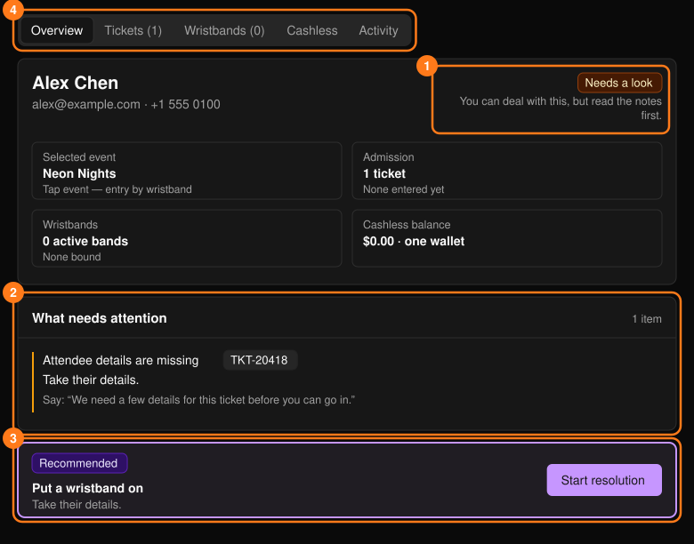
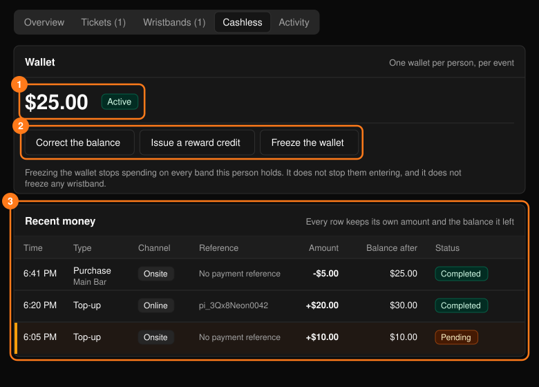
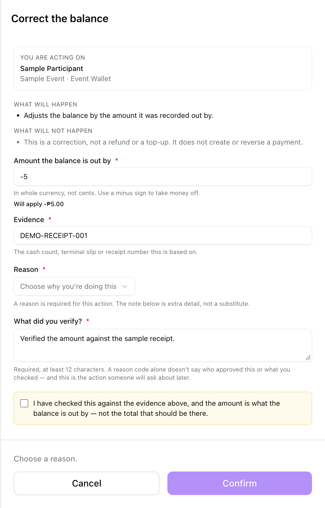
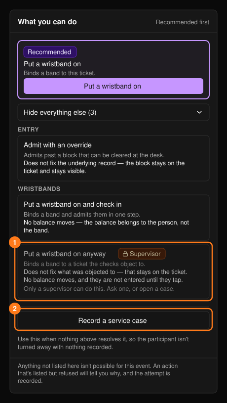

參加者個人資料（**Participant 360**）會將一個人的身分、票券、入場與無現金支付動態集中在同一個畫面。可在[搜尋](/zh-hant/onsite/search)中選擇某人，或從票券、手環、交易或工單上的連結進入。**+ Create service case**（建立服務工單）可記錄問題。

<Note>
在多場次活動中，一個人可以持有多張票券與多個手環，但只會共用一個錢包。餘額永遠不會存在手環上。
</Note>

## Overview（概覽）

**Overview** 分頁一開啟就會顯示判定結果：**Ready**（可直接處理）、**Needs a look**（請先閱讀備註）或 **Blocked**（需先解決某個問題）。

<Frame>
  
</Frame>

- **What needs attention**（待處理事項）會說明問題所在、下一步，以及一句可念給參加者聽的「Say」說明。若無法在服務台解決，請使用 **Record a service case**（記錄服務工單）。
- **Recommended action**（建議操作）中的 **Start resolution**（開始處理）會開啟該票券的引導式處理流程。請參閱[票券與入場](/zh-hant/onsite/tickets)。
- **Bought for other people**（為他人購買）會列出此人為他人購買的票券。這些票券都不屬於此人，因此不可憑其中任何一張讓此人入場；請使用 **Open that person**（開啟該人資料）。

## 分頁

**Tickets** 分頁中每張票券都有 **Resolve**（處理）按鈕。**Wristbands** 與 **Cashless** 分頁會在 Tap 活動中顯示；已更換的手環仍會保留在列表中。**Activity**（動態）是此人所有經歷的時間軸。

### Cashless（無現金支付）

此分頁會顯示錢包餘額、錢包為 Active（啟用）或 Frozen（凍結），以及近期的款項異動。全活動的帳本請參閱[無現金支付](/zh-hant/onsite/cashless)。

<Frame>
  
</Frame>

| 操作 | 用途 | 不適用於 |
| --- | --- | --- |
| **Correct the balance** | 修正記錄錯誤的金額。 | 退款或儲值。此操作不會建立或撤銷任何付款。 |
| **Issue a reward credit** | 加入補償金額，並附上參加者可看到的標籤。 | 修正金額。 |
| **Freeze the wallet** / **Unfreeze the wallet** | 停止或恢復對方所有手環上的無現金消費。 | 入場，或凍結手環。 |

這些操作都使用[操作面板](/zh-hant/onsite/tickets)。**Correct the balance**（修正餘額）還需要：

- 餘額的**差額**（而非應有的總額），以整數幣值輸入，扣款請加上負號。**Will apply**（將套用）會在你確認前顯示帶正負號的金額；
- **Evidence**（證據），例如現金盤點、刷卡機簽單或收據編號；
- **What did you verify?**（你確認了什麼？，至少 12 個字元）以及確認核取方塊。

<Frame>
  
</Frame>

**Issue a reward credit**（發放補償金額）需要以整數幣值輸入的正數金額與一個標籤。

## 可執行的操作

**What you can do**（可執行的操作）面板會提供所選票券、手環與錢包的所有操作，建議操作排在最前面，其餘則位於 **Show everything else** 下。請參閱[票券與入場](/zh-hant/onsite/tickets)、[手環](/zh-hant/onsite/wristbands)以及上方的錢包操作。

<Frame>
  
</Frame>

- 持有多張票券時，操作會套用到你在搜尋中選擇的票券，否則套用到第一張。確認前請檢查 **You are acting on**（操作對象）。
- 除非你是主管，否則 **Supervisor**（主管）操作會停用。
- 若所有操作都無法解決問題，請使用 **Record a service case**。未結案的工單也會顯示 **Service context**（服務脈絡）面板；請參閱[服務工單](/zh-hant/onsite/cases)。
