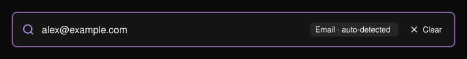
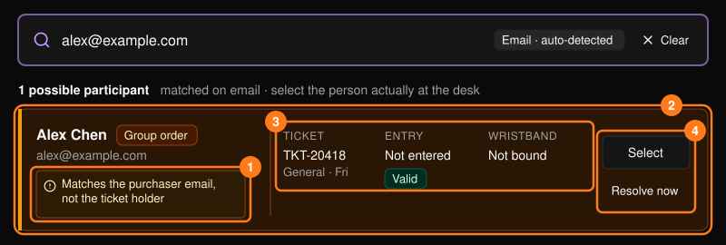
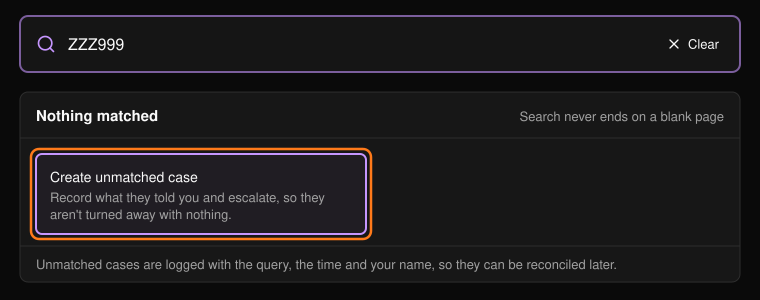

大多數服務台的處理都從搜尋開始。使用[指揮中心](/zh-hant/onsite/command-center)上的搜尋框或 **Search results**（搜尋結果）頁面。輸入至少三個字元後按下 Enter。系統會自動判斷類型並顯示在搜尋框中。

<Frame>
  
</Frame>

你可以依 Ticket ID、電子郵件或姓名（參加者或購買者）、QR Code 內容、訂單編號、付款參考編號、儲值或消費參考編號，或手環 ID 或 UID 搜尋。

## 閱讀結果

每張卡片代表一位可能的對象。請選擇實際站在服務台前的那位。

<Frame>
  
</Frame>

**Why it matched**（符合原因）最為重要。比對到持票者與比對到購買者，在入口處代表的是不同的人。比對到購買者時會以琥珀色標示。

<Warning>
不要因為某人購買了票券就讓他入場。如果卡片顯示比對到的是購買者，代表這張票屬於其他人。請改為開啟那個人的資料。
</Warning>

- **Select**（選擇）會開啟完整個人資料。請參閱[參加者](/zh-hant/onsite/participants)。
- **Resolve now**（立即處理）會略過個人資料，直接開啟該票券的引導式處理流程。請參閱[票券與入場](/zh-hant/onsite/tickets)。

## 找不到符合的結果時

在結果下方，**Nothing matched**（無符合結果）或 **Not the right person?**（不是這個人？）會建議你接下來可以嘗試的方式。**Create unmatched case**（建立未比對工單）會記錄對方告訴你的資訊，避免讓對方無功而返。請參閱[服務工單](/zh-hant/onsite/cases)。

<Frame>
  
</Frame>

<Tip>
不要修正來賓提供的資訊。對方提供的確切拼寫與大小寫，是這筆工單唯一的證據。
</Tip>
