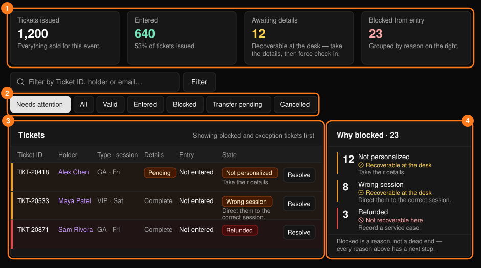
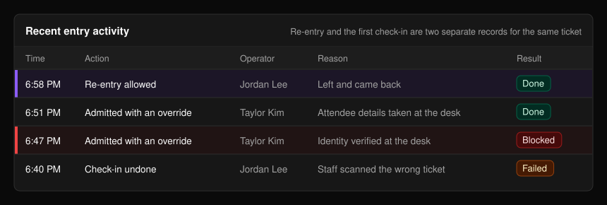
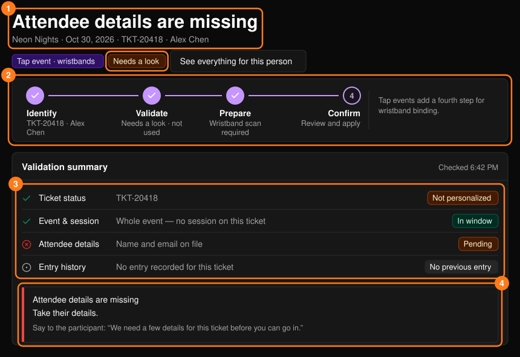
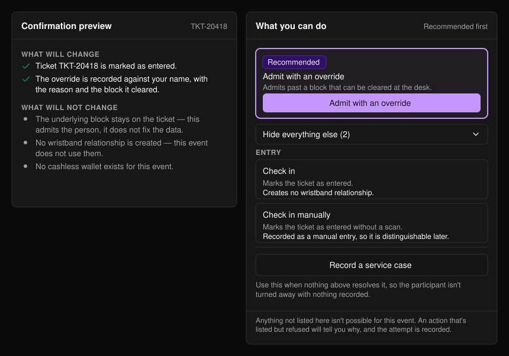
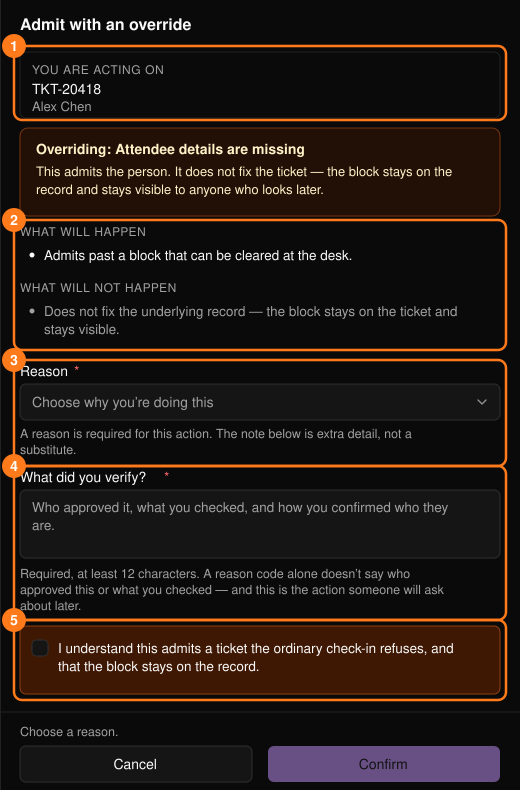

**Tickets & Entry**（票券與入場）會顯示票券是否有效、某人為何無法入場，以及如何解決。可從[指揮中心](/zh-hant/onsite/command-center)開啟，或在搜尋結果上選擇 **Resolve**（處理）。

<Note>
票種、銷售與招待票相關內容，請參閱[票券管理](/zh-hant/tickets/ticket-management)。
</Note>

## 票券列表

<Frame>
  
</Frame>

檢視按鈕（預設為 Needs attention）與 **Filter**（篩選）可依狀態、Ticket ID、持票者姓名或電子郵件縮小列表範圍。**Awaiting details**（等待資料）的票券可在服務台處理：取得資料後，以覆寫方式放行入場。

**Why blocked**（阻擋原因）面板就是你的工作佇列。每個原因都會顯示數量與下一步，並分為以下兩類：

- **可在服務台處理**：修正問題或使用覆寫。這類會列在前面，請依此順序處理。
- **無法在此處理**：任何服務台操作都無法解決。請記錄為[服務工單](/zh-hant/onsite/cases)。

點選某個原因即可將列表篩選為對應的票券。

底部的 **Recent entry activity**（近期入場動態）會記錄服務台的操作。**Done** 表示成功，**Blocked** 表示被拒絕，**Failed** 表示未完成。

<Frame>
  
</Frame>

## 處理單張票券

在票券上選擇 **Resolve**。頁面標題會說明情況，判定結果為 **Ready**（可入場）、**Needs a look**（需要確認）或 **Blocked**（已阻擋）。票券可能有效，但仍需要確認。

<Frame>
  
</Frame>

**Validation summary**（驗證摘要）會檢查票券狀態、場次、參加者資料與入場紀錄。下方的文字框會說明問題所在、下一步該怎麼做，以及一句可以直接念給參加者聽的話。**See everything for this person**（查看此人的所有資料）會開啟[參加者個人資料](/zh-hant/onsite/participants)。

在 Tap 活動中，活動設定會決定綁定手環時是否同時完成報到（**Bind wristband & check in**：任一部分失敗時，兩者皆不會套用），或是等到在入口感應手環時才入場（**Bind wristband only**）。這部分不由你選擇。

## 可執行的操作

第一個建議操作會顯示在醒目的框中。**Show everything else**（顯示其他所有操作）會展開其餘選項。該活動不可能存在的操作不會顯示；被拒絕的操作會說明原因，且該次嘗試會被記錄。當所有方法都無效時，可使用 **Record a service case**（記錄服務工單）。

<Frame>
  
</Frame>

| 操作 | 說明 |
| --- | --- |
| **Check in** / **Check in manually** | 純票券活動。將票券標記為已入場；手動報到會另外記錄。 |
| **Admit with an override** | 對可在服務台排除的阻擋原因進行覆寫放行。阻擋紀錄仍會顯示在票券上。 |
| **Allow re-entry** | 將再次入場記錄為獨立事件；首次報到紀錄永遠不會被覆寫。 |
| **Undo check-in** | 將票券恢復為未使用。不會撤銷之後的消費，也不會從紀錄中移除該次入場。 |

Tap 活動以感應手環入場，因此需透過手環處理。請參閱[手環](/zh-hant/onsite/wristbands)；錢包相關操作請參閱[參加者](/zh-hant/onsite/participants)與[無現金支付](/zh-hant/onsite/cashless)。執行撤銷前，**If you undo this entry**（如果撤銷此入場）會列出之後發生的所有事項。

## 操作面板

每項操作都會開啟相同的側邊面板。

<Frame>
  
</Frame>

請先檢查 **You are acting on**（操作對象）（1）。選擇一個 **Reason**（原因）（3）；只填備註是不夠的。在所有必填項目完成前，**Confirm**（確認）會維持停用。若操作失敗，不會有任何變更，你可以重試或記錄工單。

<Warning>
覆寫時，**What did you verify?**（你確認了什麼？）須填寫至少 12 個字元（誰核准、你檢查了什麼、如何確認對方身分），並勾選核取方塊。你的姓名會被記錄。
</Warning>

## 權限

標示 **Supervisor**（主管）的操作會顯示給所有人，但只有主管可以使用。否則請詢問主管，或開立工單。

<Note>
主控台不會進行退款或作廢票券。請將這類需求記錄為[服務工單](/zh-hant/onsite/cases)以供審查。
</Note>
