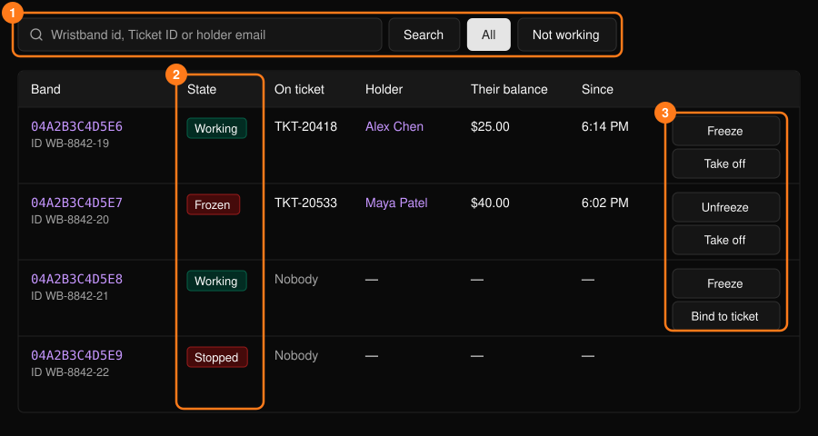
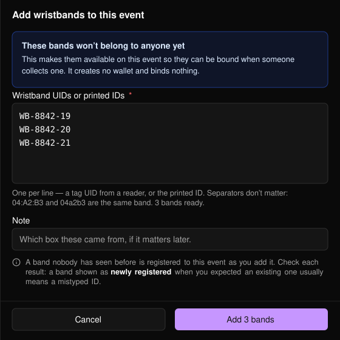
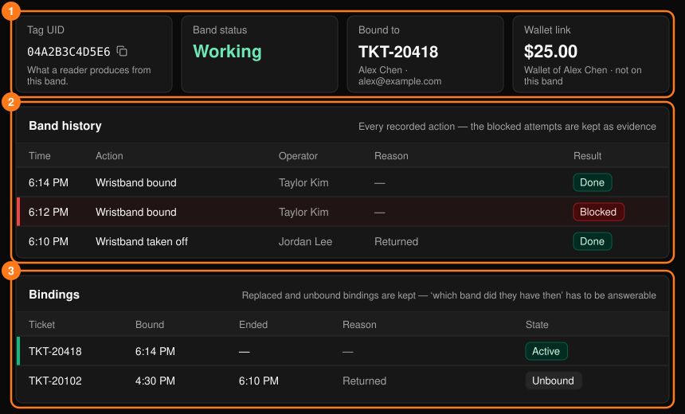
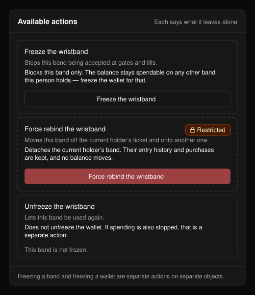
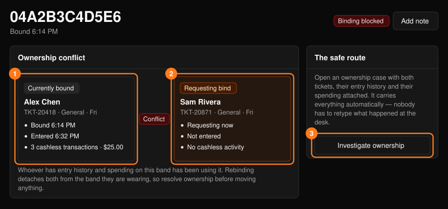

**Wristbands**（手環）工作區僅適用於 Tap 活動。可從[指揮中心](/zh-hant/onsite/command-center)開啟。

<Warning>
餘額屬於人，而不屬於手環。更換手環不會轉移金額，凍結手環也不會凍結餘額。若要停止消費，請從參加者的個人資料中凍結錢包。請參閱[參加者](/zh-hant/onsite/participants)。
</Warning>

## 手環列表

可依手環 ID、Ticket ID 或持有者電子郵件搜尋。**Not working**（無法使用）會列出已停用的手環。

<Frame>
  
</Frame>

列操作包括：**Freeze** / **Unfreeze**（凍結／解除凍結，手環停止或恢復入場與付款功能）、**Take off**（取下，結束綁定）以及 **Bind to ticket**（綁定至票券，需輸入 Ticket ID）。這些操作都使用[操作面板](/zh-hant/onsite/tickets)。凍結不會影響餘額與票券；取下不會影響餘額、入場紀錄與消費紀錄。

**Bind to ticket** 依活動設定而定：**Put a wristband on and check in**（戴上手環並報到），或 **Put a wristband on**（戴上手環，對方在入口感應手環時入場）。

## 新增手環

在開放入場前，選擇 **+ Add wristbands**（新增手環）登記備用手環。

<Frame>
  
</Frame>

<Steps>
  <Step title="輸入手環">
    每行一組 UID 或印刷 ID。若讀取器每次感應後會自動換行，便會直接幫你填入。格式不拘，重複的項目會被忽略。
  </Step>
  <Step title="加入備註（選填）">
    例如這批手環來自哪一箱。
  </Step>
  <Step title="選擇 Add">
    每次最多 200 個。
  </Step>
</Steps>

此操作不會建立錢包，也不會綁定任何東西。結果會列出每個手環為新登記、已可使用，或被拒絕並附上原因。請逐行檢查：若原本預期是既有的手環卻顯示為新登記，通常代表 ID 輸入錯誤。

<Frame>
  
</Frame>

## 手環頁面

選擇手環即可查看其摘要、**Band history**（手環紀錄）與 **Bindings**（綁定紀錄）。被拒絕的嘗試與已被取代的綁定會刻意保留，以便隨時能回答「發生了什麼事」以及「當時對方持有哪個手環」。**Add note**（新增備註）會開啟[工單表單](/zh-hant/onsite/cases)。

<Frame>
  
</Frame>

### 可用操作

每項操作都會說明它會做什麼、不會影響什麼；無法使用的操作會說明原因。

<Frame>
  
</Frame>

| 操作 | 說明 |
| --- | --- |
| **Put a wristband on** | 將手環綁定至票券。不會轉移餘額。 |
| **Replace the wristband** | 停用舊手環，並將新手環（輸入其 ID）綁定至同一張票券。 |
| **Take the wristband off** | 結束綁定。不會為對方辦理離場，也不會影響餘額。 |
| **Report the wristband lost or stolen** | 停用手環並結束所有綁定。不會發放替換手環，也不會凍結錢包。 |
| **Freeze** / **Unfreeze the wristband** | 僅停用或恢復此手環。餘額仍可在對方持有的其他手環上使用。 |
| **Put a wristband on anyway**（受限） | 略過未通過的檢查強制綁定。不會解決被提出的問題。 |
| **Force rebind the wristband**（受限） | 將手環從目前持有者的票券移至另一張票券。原持有者的入場紀錄與消費紀錄會保留。 |

大多數操作都需要填寫原因。**Restricted**（受限）操作僅限主管使用，會以你的姓名記錄，且 **What did you verify?** 須填寫至少 12 個字元並勾選確認核取方塊。

### 持有權衝突

若某張票券嘗試綁定已綁定給他人的手環，頁面會顯示 **Binding blocked**（綁定已阻擋），以及比較 **Currently bound**（目前綁定）與 **Requesting bind**（申請綁定）的 **Ownership conflict**（持有權衝突）面板。在該手環上有入場與消費紀錄的人，就是一直在使用它的人。

<Frame>
  
</Frame>

重新綁定會讓雙方都與自己配戴的手環脫鉤，因此請先確認持有權。選擇 **Investigate ownership**（調查持有權）以記錄工單並向上呈報。之後主管可使用 **Force rebind the wristband**。
