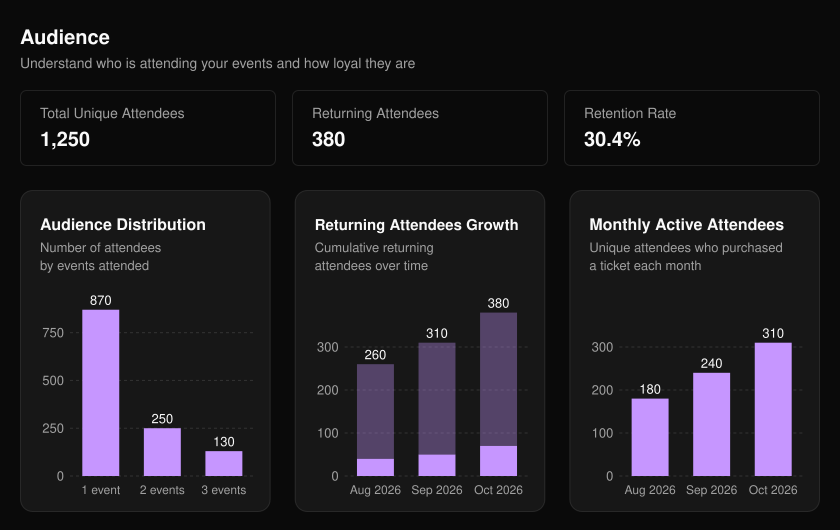
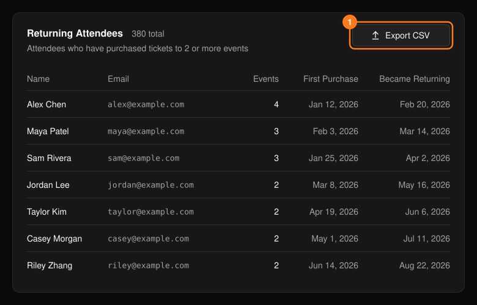

頁首的 **Audience**（受眾）顯示的是整個組織的參加者忠誠度，而不是單一活動。Retention Rate（留存率）是回訪參加者佔所有不重複參加者的百分比。

<Frame>
  
</Frame>

- **Audience Distribution**（受眾分布）：依參加過的活動場數將參加者分組。
- **Returning Attendees Growth**（回訪參加者成長）：顯示回訪參加者隨時間累積的人數。
- **Monthly Active Attendees**（每月活躍參加者）：統計每個月購票的不重複參加者人數。

## 回訪參加者

**Returning Attendees**（回訪參加者）表格會列出所有購買過你 2 場以上活動票券的人。選擇 **Export CSV**（匯出 CSV）即可下載。

<Frame>
  
</Frame>

<Note>
  匯出的檔案包含姓名與電子郵件地址。請只分享給需要的團隊成員。
</Note>
