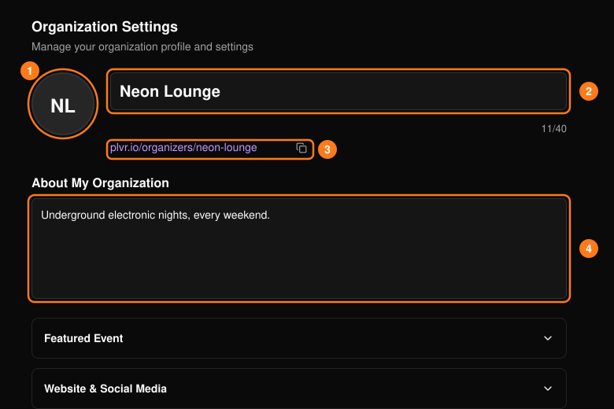
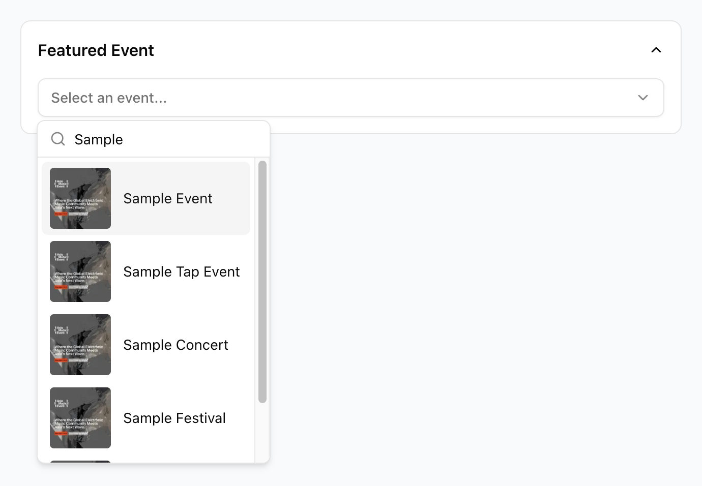
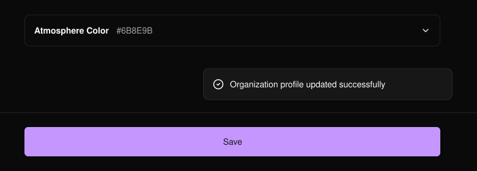

頁首的 **Organization**（組織）用於控制你的組織在公開主辦方頁面上的呈現方式。

<Note>
  只有擁有者、管理員與經理可以開啟此頁面。
</Note>

<Frame>
  
</Frame>

- **Logo（1）**（標誌）：PNG、WebP、JPG 或 JPEG，最大 4 MB。
- **Name（2）**（名稱）：必填，最多 40 個字元。
- **Page URL（3）**（頁面網址）：於建立組織時設定，無法在此變更。
- **About（4）**（簡介）：顯示在你的公開頁面上。

## 選填區塊

展開區塊即可在公開主辦方頁面上加入更多資訊。

- **Featured Event**（精選活動）：從下拉選單選擇一個活動來重點展示，然後儲存。
  <Frame>
    
  </Frame>
- **Website & Social Media**（網站與社群媒體）：加入可公開存取的網站、Instagram、X / Twitter、Facebook、TikTok 與 YouTube 連結。網站必須以 `http://` 或 `https://` 開頭。
- **Community Groups**（社群群組）：加入一個 WhatsApp 或 Telegram 邀請連結。儲存其中一個會清除另一個。
- **Music**（音樂）：加入 SoundCloud 或 Spotify 的藝人或播放清單連結。
- **Venue Information**（場地資訊）：如果你的組織經營實體場地，請勾選此核取方塊。
- **Public Metrics**（公開數據）：使用 **Display Number of Attendees**（顯示參加人數）來顯示或隱藏參加人數。
- **Atmosphere Color**（氛圍色彩）：選擇組織的代表色。若要使用自訂顏色，請選擇 **Apply Color**（套用顏色），然後儲存。

## 儲存

選擇頁面底部的 **Save**（儲存）。如果你在有未儲存變更的情況下離開，系統會請你確認。

<Frame>
  
</Frame>
