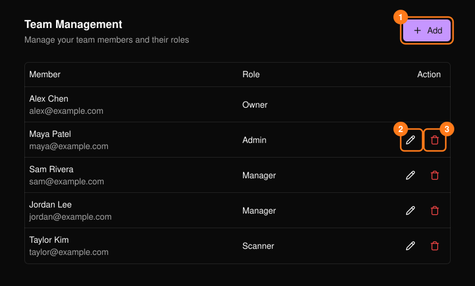
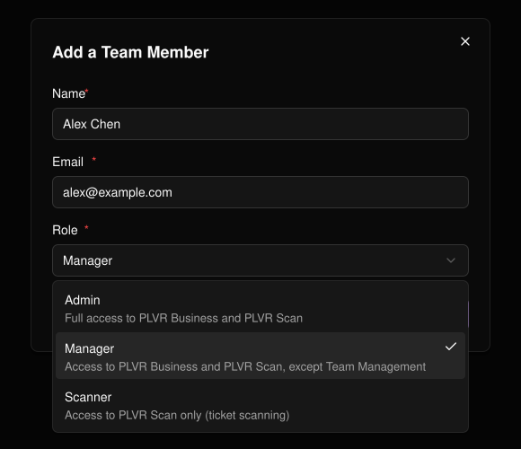

頁首的 **Team**（團隊）用於控制誰可以在你的組織中工作。

<Note>
  只有擁有者與管理員可以開啟此頁面。
</Note>

| 角色 | 權限 |
| --- | --- |
| **Admin**（管理員） | 可使用 PLVR Business 與 PLVR Scan 的所有功能。 |
| **Manager**（經理） | 可使用 PLVR Business 與 PLVR Scan，但不含 Team Management（團隊管理）。 |
| **Scanner**（掃碼員） | 僅可使用 PLVR Scan（票券掃碼）。 |

**擁有者**（建立組織的人）會列在名單中，但無法被編輯或移除。

<Frame>
  
</Frame>

## 新增成員

<Steps>
  <Step title="選擇 Add（1）">
    輸入對方的姓名、電子郵件與角色。所有欄位皆為必填。
  </Step>
  <Step title="選擇 Save">
    該成員就會出現在列表中。
  </Step>
</Steps>

<Frame>
  
</Frame>

## 變更角色或移除成員

使用鉛筆圖示（2）變更角色；姓名與電子郵件無法修改。使用垃圾桶圖示（3）移除成員，然後確認。

<Warning>
  如果你把自己的角色改成無法存取 Team 的角色，可能會立即失去此頁面的存取權限。
</Warning>
