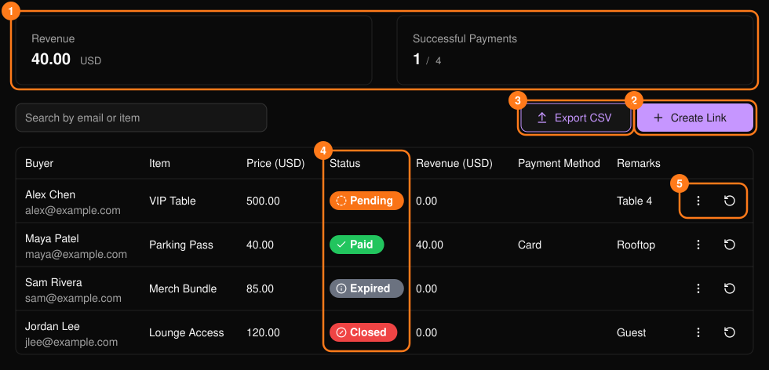
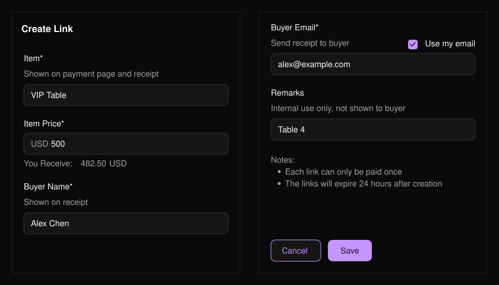
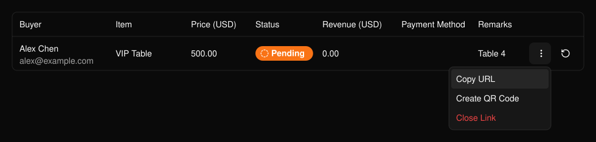
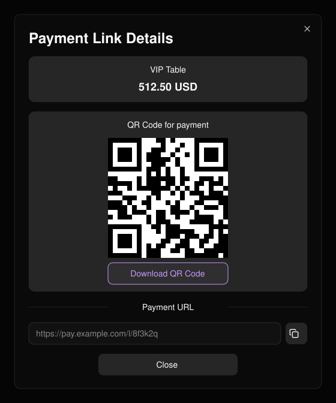

**Payment Links**（付款連結）讓你不必建立票種，就能針對特定項目（例如 VIP 桌位）收取特定金額。建立連結、傳送給買家，並追蹤付款狀態。

<Frame>
  
</Frame>

<Warning>
  每個連結只能付款一次，並會在建立 24 小時後失效。
</Warning>

## 建立連結

<Steps>
  <Step title="選擇 Create Link（2）">
    輸入 **Item**（項目）與 **Item Price**（項目價格，須大於零）。**You Receive**（你的實收）會顯示扣除費用後的金額。
  </Step>
  <Step title="輸入買家資料">
    買家姓名與電子郵件為必填，收據會寄送到該電子郵件。**Remarks**（備註）僅供內部使用。
  </Step>
  <Step title="選擇 Save">
    然後分享連結。
  </Step>
</Steps>

<Frame>
  
</Frame>

## 管理連結

使用列選單（5）可 **Copy URL**（複製網址）、**Create QR Code**（建立 QR Code）或 **Close Link**（關閉連結，適用於待付款連結），或 **Download Receipt**（下載收據，適用於已付款連結）。已關閉的連結無法重新開啟。使用重新整理按鈕確認連結是否已付款。

<Frame>
  
</Frame>

<Frame>
  
</Frame>
