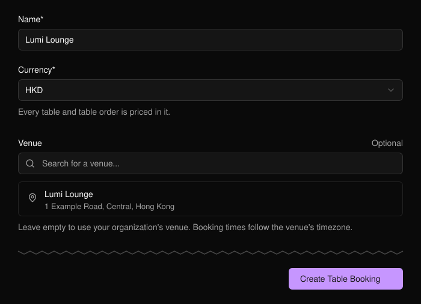
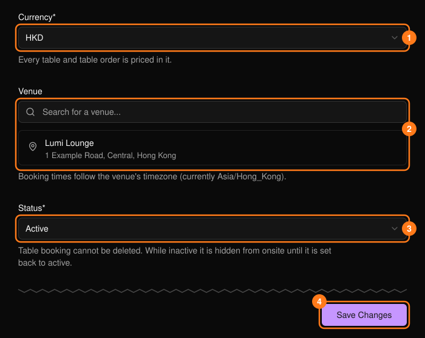
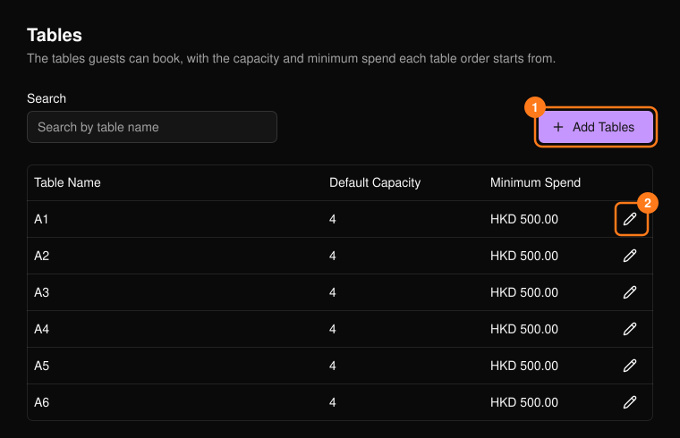
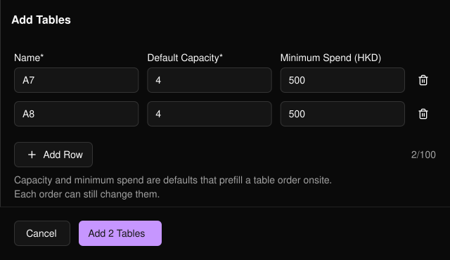

訂位功能讓來賓可以預訂桌位。此功能以組織為單位設定一次，而非針對每個活動設定，並分為兩部分：**Settings**（設定）與 **Tables**（桌位）。

<Note>
  **Table Booking**（訂位）僅會在擁有者、管理員與經理的頂端導覽列中顯示。
</Note>

## 設定

<Steps>
  <Step title="開啟 Table Booking">
    填寫設定表單。**Name**（名稱）與 **Currency**（幣別）為必填。
  </Step>
  <Step title="選擇 Create Table Booking">
    你會直接進入 **Tables**。
  </Step>
  <Step title="新增桌位">
    在建立桌位之前，無法進行任何預訂。
  </Step>
</Steps>

<Frame>
  
</Frame>

## Settings（設定）

設定內容包括你的標誌、名稱、幣別、場地、座位圖、酒水菜單與規則。

<Frame>
  
</Frame>

- **Venue**（場地）留空時會使用組織的場地。預訂時間依該場地的時區計算。
- 將 **Status**（狀態）（3）設為 Inactive 即可在現場隱藏訂位功能。訂位功能無法刪除。

<Warning>
  變更幣別（1）不會換算既有金額。定價 500 的桌位仍會是 500。
</Warning>

## Tables（桌位）

每張桌位都有預設容納人數與最低消費，會預先填入現場桌位訂單；每筆訂單都可另行變更。桌位無法刪除。

<Frame>
  
</Frame>

**Add Tables**（新增桌位）（1）可一次新增多張桌位。填寫第一列後使用 **Add Row**（新增列）：名稱會自動遞增（A1、A2），容納人數與最低消費也會沿用。每次最多 100 列。

<Frame>
  
</Frame>

- 名稱不可重複（不區分大小寫與空格），最多 64 個字元。
- 容納人數為 1 至 100。最低消費不可為負數。
- 使用鉛筆圖示（2）編輯桌位。既有訂單會保留其原本的數值。
