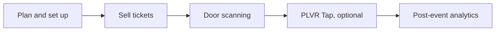

每場活動都會經歷三個階段。透過這些頁面了解下一步該做什麼。

<Steps>
  <Step title="活動前">
    規劃活動、設定票券與表單、進行宣傳，並讓團隊做好準備。選用：如果活動採無現金支付，請設定 PLVR Tap。
  </Step>
  <Step title="活動中">
    掃碼讓來賓入場、現場售票、管理服務台，並處理無現金相關問題與工單。
  </Step>
  <Step title="活動後">
    閱讀報表、檢查消費與優惠成效，並與你的受眾保持聯繫。
  </Step>
</Steps>

<CardGroup cols={3}>
  <Card title="活動前" icon="calendar-check" href="/zh-hant/phases/before">
    規劃與售票。
  </Card>
  <Card title="活動中" icon="ticket" href="/zh-hant/phases/during">
    掃碼、現場售票與現場營運。
  </Card>
  <Card title="活動後" icon="chart-line" href="/zh-hant/phases/after">
    報表與後續追蹤。
  </Card>
</CardGroup>

## 實戰手冊

- [上線檢查清單](/zh-hant/guides/launch-checklist)
- [宣傳你的活動](/zh-hant/guides/promote-your-event)
- [無現金音樂節設定](/zh-hant/guides/cashless-festival-setup)
- [活動當天執行手冊](/zh-hant/guides/event-day-runbook)
- [活動結束後](/zh-hant/guides/after-the-event)

## 想找你的活動類型？

請參閱[小型活動](/zh-hant/organizers/small-events)、[中型活動](/zh-hant/organizers/mid-size-events)、[音樂節](/zh-hant/organizers/festivals)或[定期社群活動](/zh-hant/organizers/recurring-community)。若想依職務查看，請參閱[依團隊的指南](/zh-hant/roles)。
