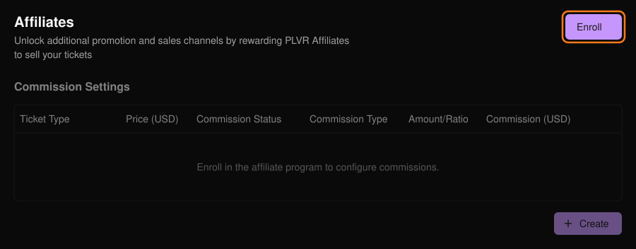
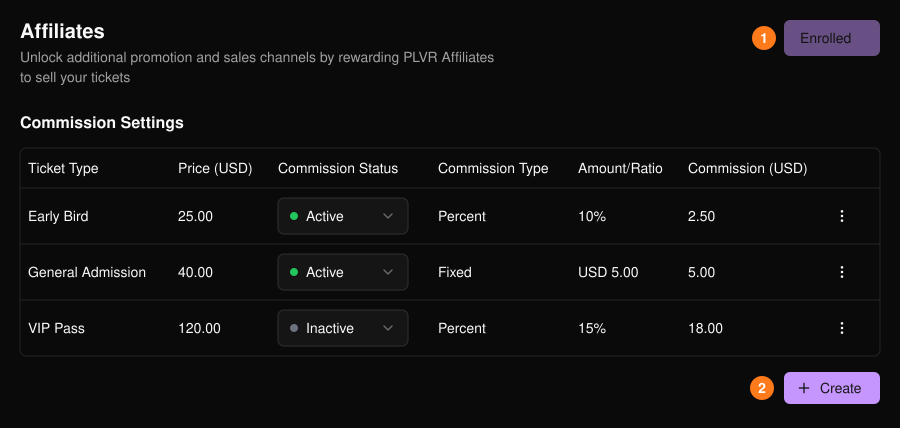
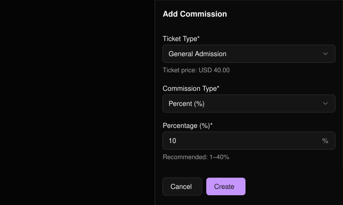

獎勵協助銷售你票券的 PLVR 推廣夥伴（PLVR Affiliates）。只需為活動加入一次，再為各票種設定佣金即可。

<Warning>
  加入後無法取消。加入之前，佣金設定會維持灰色無法使用。
</Warning>

<Frame>
  
</Frame>

## 新增佣金

<Steps>
  <Step title="加入">選擇 **Enroll**（加入）（1）。</Step>
  <Step title="建立">選擇 Commission Settings（佣金設定）表格下方的 **Create**（建立）（2）。</Step>
  <Step title="選擇票種">已設定佣金的票種不會出現在選項中。</Step>
  <Step title="設定佣金">選擇 **Percent (%)**（百分比）或 **Fixed Amount**（固定金額），輸入金額後選擇 **Create**。百分比須為 100 以內的整數（建議 1% 至 40%）。</Step>
</Steps>

<Frame>
  
</Frame>

<Frame>
  
</Frame>

## 編輯或暫停

使用列尾的選單並選擇 **Edit**（編輯）以變更類型或金額。若要暫停佣金，請將其 **Commission Status**（佣金狀態）設為 **Inactive**（停用）。

<Tip>
  若要用你自己的連結追蹤合作夥伴，請建立帶有推廣夥伴 ID 的[追蹤連結](/zh-hant/promotions/tracking-links)。推廣代碼也會顯示在[票券報表](/zh-hant/tickets/ticket-report)中。
</Tip>
