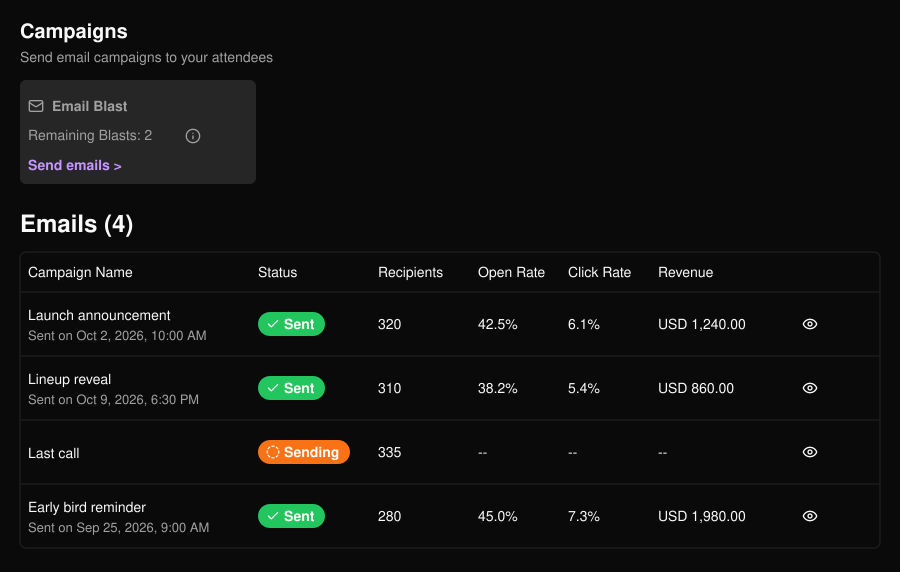
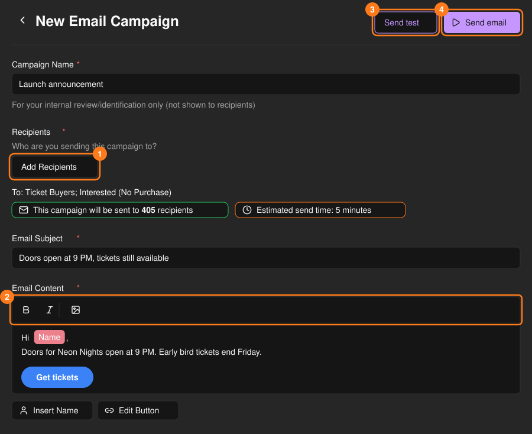
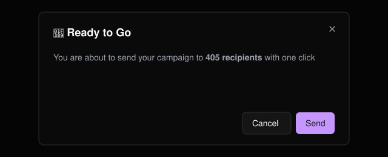
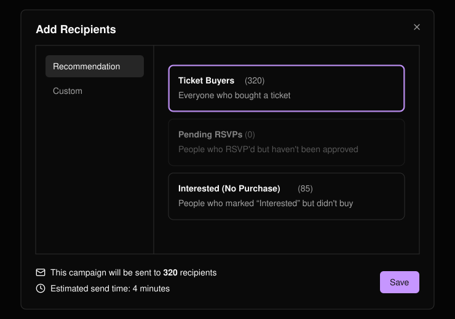
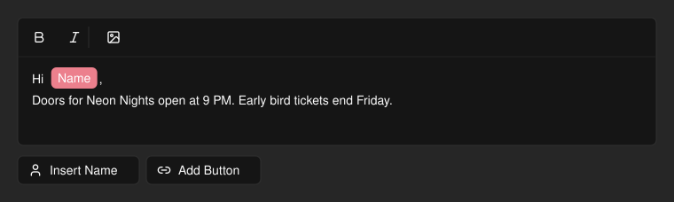
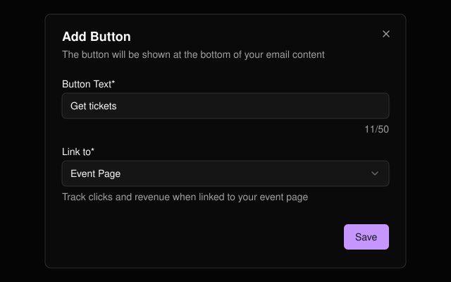

寄送活動相關的群發郵件，並在同一頁面追蹤開信、點擊與營收。確認後行銷郵件會立即寄出。沒有草稿功能，已寄出的郵件也無法編輯。

<Note>
  每個活動每週的群發次數有上限。**Remaining Blasts**（剩餘群發次數）會顯示剩餘次數，歸零時將無法寄送。
</Note>

<Frame>
  
</Frame>

## 建立並寄送行銷郵件

選擇 **Send emails >**。

<Steps>
  <Step title="命名">行銷活動名稱僅供你自己辨識，收件人不會看到。</Step>
  <Step title="新增收件人">選擇收件對象（見下方說明）。</Step>
  <Step title="撰寫郵件">輸入主旨與內容。</Step>
  <Step title="寄送測試">選擇 **Send test**（寄送測試）將預覽寄給自己。</Step>
  <Step title="寄送">選擇 **Send email**（寄送郵件），確認收件人數後再確認寄出。</Step>
</Steps>

<Frame>
  
</Frame>

<Frame>
  
</Frame>

<Warning>
  主旨或內容含有限制字詞時會被封鎖，測試郵件也一樣。訊息中會列出需要修改的字詞。
</Warning>

## 選擇收件人

只有儲存時所在的分頁會被採用。

<Tabs>
  <Tab title="Recommendation（推薦）">
    選擇一個或多個群組：**Ticket Buyers**（購票者）、**Pending RSVPs**（待審核 RSVP）或 **Interested (No Purchase)**（感興趣但未購買）。空的群組無法選取。
  </Tab>
  <Tab title="Custom（自訂）">
    上傳 CSV（請使用 **Download Template**，需包含 **Email** 欄位）或逐一輸入地址。無效與重複的地址會被略過。
  </Tab>
</Tabs>

<Frame>
  
</Frame>

選擇後會立即顯示預估收件人數與寄送時間。

## 郵件編輯器

可設定文字格式、插入圖片，或使用 **Insert Name**（插入姓名）以收件人的名字問候對方。**Add Button**（新增按鈕）會在郵件底部加入行動呼籲按鈕。

<Frame>
  
</Frame>

<Frame>
  
</Frame>

<Tip>
  將按鈕的 **Link to**（連結至）設為 **Event Page**（活動頁面），點擊與營收才會在行銷活動列表中被追蹤。**Custom URL**（自訂網址）無法追蹤。
</Tip>
