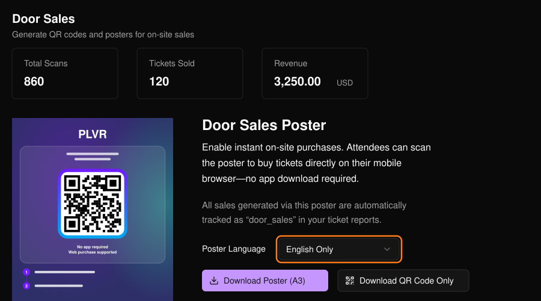
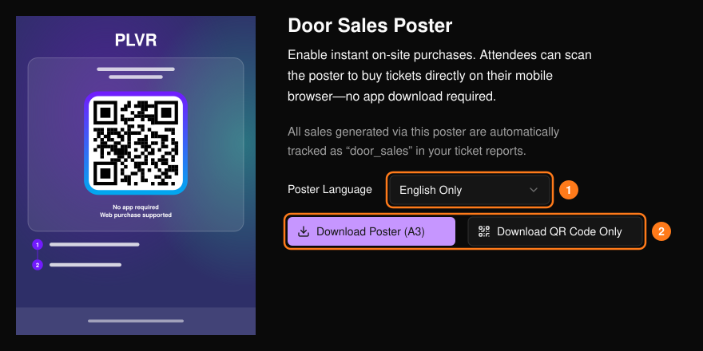

來賓掃描 QR Code 後會進入你的活動頁面，並直接用手機購票。這些購買會計為現場售票，頁面上方會顯示掃描次數、售出票數與營收。透過海報 QR Code 完成的購買，在[票券報表](/zh-hant/tickets/ticket-report)中會以 `door_sales` 標示。

<Frame>
  
</Frame>

## 取得海報或 QR Code

<Steps>
  <Step title="選擇語言">選擇海報語言（1），預覽會隨之更新。</Step>
  <Step title="下載">選擇 **Download Poster (A3)** 下載可直接列印的海報，或選擇 **Download QR Code Only**（僅下載 QR Code）（2）。</Step>
</Steps>

<Frame>
  
</Frame>

<Tip>
  列印前，請先用手機掃描海報。確認活動頁面能正常開啟、要販售的票種可購買，且結帳流程正常。

  將海報張貼在入口或售票處。單獨的 QR Code 可用於桌卡、螢幕或工作人員識別證。請工作人員引導來賓前往海報、協助結帳，並依活動的入場流程驗證電子票券。其他通路請參閱[追蹤連結](/zh-hant/promotions/tracking-links)。
</Tip>
