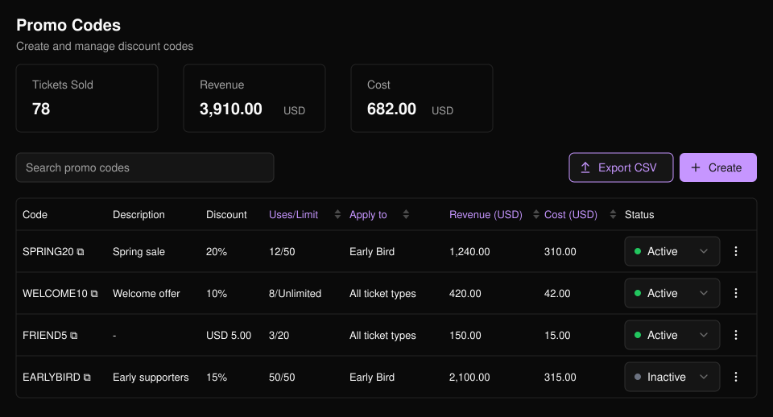
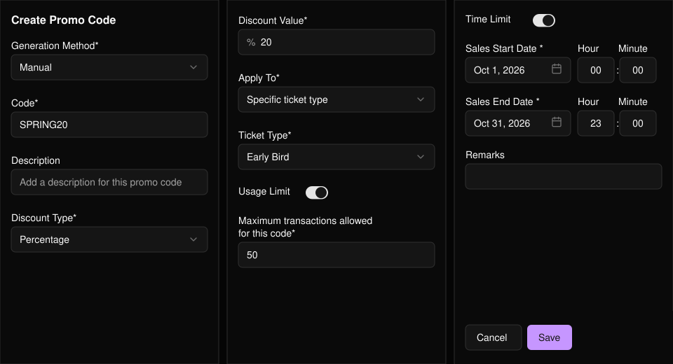
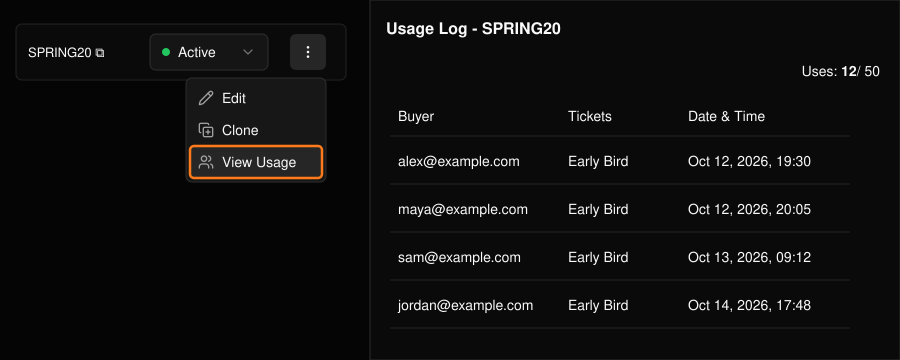

提供百分比或固定金額折扣。可逐一建立優惠碼，或一次產生多組。

<Frame>
  
</Frame>

列表會顯示每組優惠碼相對於上限的使用量，以及營收與成本。可直接在表格中變更優惠碼的 **Status**（狀態），或選擇 **Export CSV** 下載列表。

## 建立優惠碼

選擇 **Create**（建立）。

<Steps>
  <Step title="選擇建立方式">
    **Manual**（手動）用於輸入單一優惠碼，**Bulk Generate**（批次產生）可產生最多 100 組優惠碼，並可選擇加上前綴。

    <Frame>
      
    </Frame>
  </Step>
  <Step title="設定折扣">
    選擇 **Percentage**（百分比）或 **Fixed Amount**（固定金額）並輸入數值。
  </Step>
  <Step title="選擇適用範圍">
    所有票種，或特定場次與票種。
  </Step>
  <Step title="加入限制（選填）">
    開啟 **Usage Limit**（使用上限，最多訂單數）和／或 **Time Limit**（期間限制，開始與結束時間）。若未設定，優惠碼將不會用完或過期。
  </Step>
  <Step title="儲存">
    **Description**（說明）會顯示在列表中，**Remarks**（備註）則供你自己記錄。
  </Step>
</Steps>

<Frame>
  
</Frame>

## 編輯、複製或查看使用紀錄

使用列尾的選單。

- **Edit**（編輯）：變更設定或開啟／關閉優惠碼。優惠碼文字無法變更。
- **Clone**（複製）：以相同設定建立新的優惠碼。
- **View Usage**（查看使用紀錄）：查看每一筆使用該優惠碼的訂單。

<Frame>
  
</Frame>

<Tip>
  若要查看個別訂單使用的優惠碼，請在[票券報表](/zh-hant/tickets/ticket-report)中加入 **Promo Code** 欄位。
</Tip>
