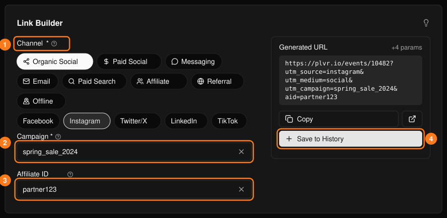
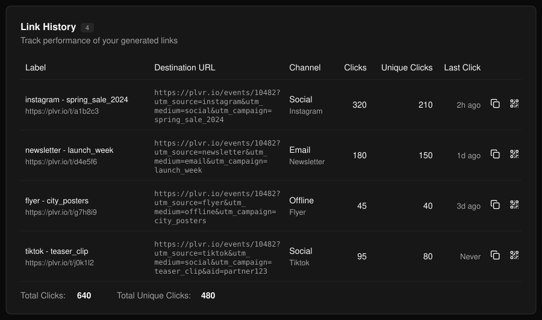
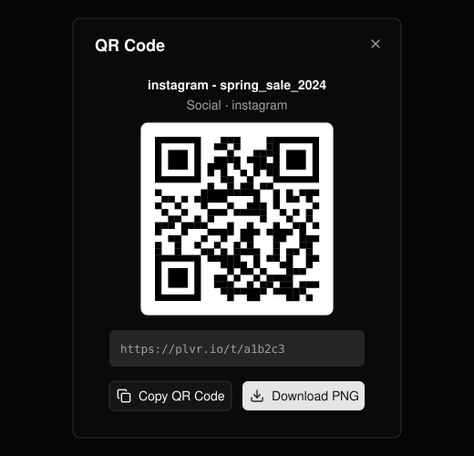

透過 Instagram、電子報或傳單等通路分享你的活動頁面，並了解哪些通路帶來了訪客。

## 建立連結

<Steps>
  <Step title="選擇通路">選擇類別，再選擇子通路（1）。</Step>
  <Step title="為行銷活動命名">必填。請在各通路使用一致的命名，並以底線取代空格（2）。</Step>
  <Step title="加入推廣夥伴 ID（選填）">追蹤特定合作夥伴帶來的轉介（3）。</Step>
  <Step title="儲存">選擇 **Copy**（複製）取得連結，並選擇 **Save to History**（儲存至紀錄）（4）保存連結並開始計算點擊數。</Step>
</Steps>

<Frame>
  
</Frame>

<Note>
  只有已儲存的連結才會產生短網址並計算點擊數。請儲存每一個你打算分享的連結。
</Note>

## Link History（連結紀錄）

已儲存的連結會顯示在這裡，並附上總點擊數與不重複點擊數。使用列上的按鈕可複製短網址，或開啟其 **QR Code**，並可複製或下載為 PNG。

<Frame>
  
</Frame>

<Frame>
  
</Frame>

現場銷售請參閱[現場售票](/zh-hant/promotions/door-sales)。
