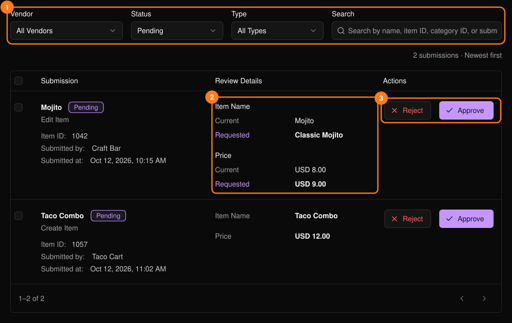
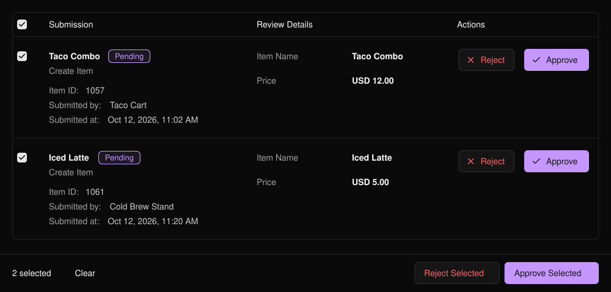

商家新增或變更品項或分類時，該內容會在此等待審核，在你核准之前不會出現在商家的菜單上。此功能位於活動側邊欄的 **PLVR Tap** 下。

<Frame>
  
</Frame>

頁面預設顯示 **Pending**（待審核）的提交內容。使用篩選器（1）依狀態、類型或商家尋找其他內容。若為修改，請比較 **Current**（目前）與 **Requested**（申請變更）（2）。

## 審核提交內容

<Steps>
  <Step title="檢查內容">點選圖片即可放大。</Step>
  <Step title="核准或拒絕（3）">**Approve**（核准）會套用提交內容。**Reject**（拒絕）需填寫原因，商家可看到該原因。</Step>
</Steps>

## 批次審核

勾選列或標題列的核取方塊，即會顯示 **Approve Selected**（核准所選）與 **Reject Selected**（拒絕所選）。最多可選取 50 筆，批次拒絕會對所有項目使用同一個原因。期間內有變動的提交內容會被略過。

<Frame>
  
</Frame>

<Tip>
停用商家的提交內容仍可審核。核准前請留意 **Inactive** 標籤。
</Tip>

## 相關內容

- [商家](/zh-hant/tap/vendors)
- [PLVR Tap 總覽](/zh-hant/tap/introduction)
