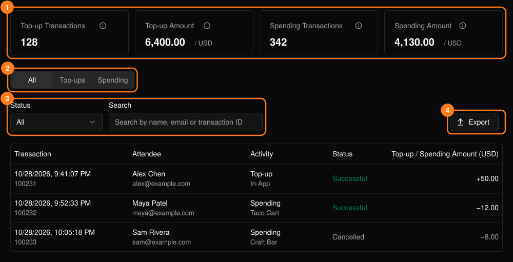
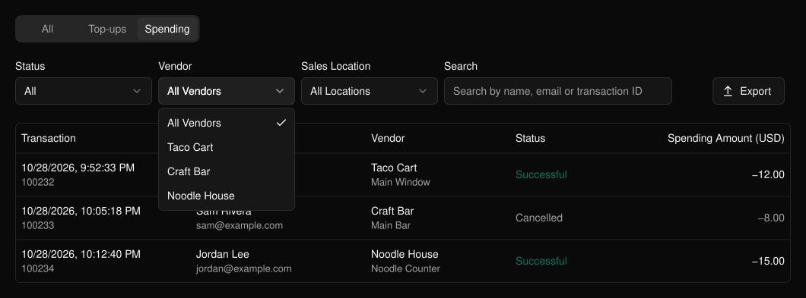

列出參加者錢包的儲值紀錄與在商家的消費紀錄。此功能位於活動側邊欄的 **PLVR Tap** 下。

<Frame>
  
</Frame>

摘要卡片（1）僅計算成功的交易。Top-up Amount（儲值金額）不含服務費與稅金。

## 篩選與匯出

在 **All**（全部）、**Top-ups**（儲值）與 **Spending**（消費）之間切換（2）。每個分頁都有各自的篩選器（3），例如狀態、儲值管道與儲值站、商家與銷售地點，或依姓名、電子郵件或交易 ID 搜尋。

已取消的交易會以灰色顯示。選擇 **Export**（匯出）（4）即可依目前分頁與篩選條件下載 CSV。

<Frame>
  
</Frame>

## 相關內容

- [消費報表](/zh-hant/tap/spending-report)：依商家與品項查看總計
- [現場無現金交易](/zh-hant/onsite/cashless)：處理個別交易
