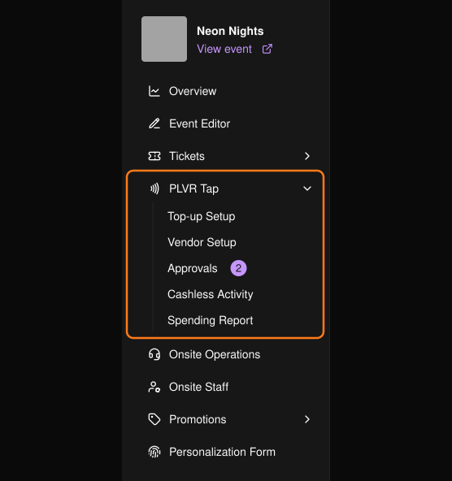

PLVR Tap 讓參加者只要感應手環即可付款。每位參加者都有一個 Event Wallet（活動錢包）：先儲值，再到商家攤位消費。你在活動前完成設定，活動後進行查核。

<Note>
PLVR Tap 相關頁面只會在已啟用 PLVR Tap 的活動中顯示。
</Note>

<Frame>
  
</Frame>

## 運作方式

<Steps>
  <Step title="活動前">
    建立[儲值站](/zh-hant/tap/top-up-setup)、設定[商家](/zh-hant/tap/vendors)並發放登入碼、選擇[個人化表單](/zh-hant/tap/personalization-form)中要詢問參加者的問題，並[審核商家菜單](/zh-hant/tap/approvals)。
  </Step>
  <Step title="活動當天">
    工作人員在入場時為每張票券綁定一個手環。參加者可線上儲值，或在儲值站以現金或刷卡儲值。商家掃描手環即可收款。
  </Step>
  <Step title="活動後">
    查看[無現金交易紀錄](/zh-hant/tap/cashless-activity)與[消費報表](/zh-hant/tap/spending-report)，然後與商家結算。
  </Step>
</Steps>

## 接下來

<CardGroup cols={2}>
  <Card title="儲值設定" icon="wallet" href="/zh-hant/tap/top-up-setup">儲值站與付款方式。</Card>
  <Card title="商家" icon="store" href="/zh-hant/tap/vendors">商家、銷售地點、品項與登入碼。</Card>
  <Card title="審核" icon="circle-check" href="/zh-hant/tap/approvals">審核商家提交的內容。</Card>
  <Card title="現場手環管理" icon="nfc" href="/zh-hant/onsite/wristbands">在活動期間管理手環。</Card>
</CardGroup>
