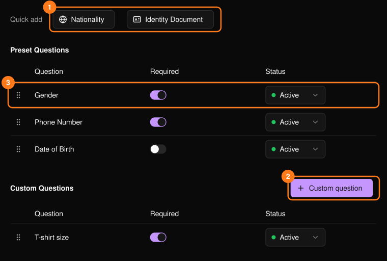
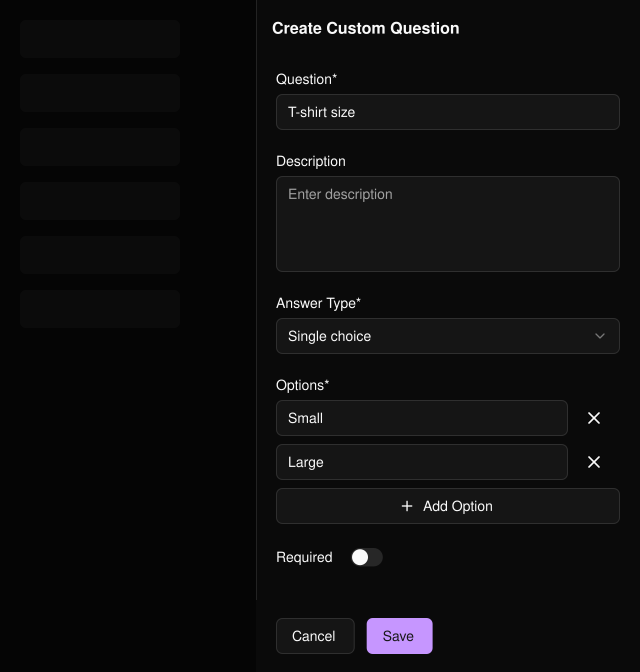

參加者在個人化或領取票券時會回答這些問題。此表單與[報名表單](/zh-hant/events/registration-form)是分開的。姓名與電子郵件一律會收集，因此不會列在這裡。

<Frame>
  
</Frame>

## 新增問題

- **Quick add**（快速新增）（1）：新增標準問題（Gender、Nationality、Phone Number、Date of Birth、Identity Document），預設為必填。
- **Custom question**（自訂問題）（2）：選擇回答類型（文字、數字、單選或複選）。選擇題類型須至少有一個選項。

<Frame>
  
</Frame>

## 管理問題

在每一列（3）上，可切換 **Required**（必填）、將 **Status**（狀態）設為 **Inactive**（停用）以停止詢問，或拖曳把手調整順序。

## 相關內容

- [PLVR Tap 總覽](/zh-hant/tap/introduction)
- [手環](/zh-hant/onsite/wristbands)
