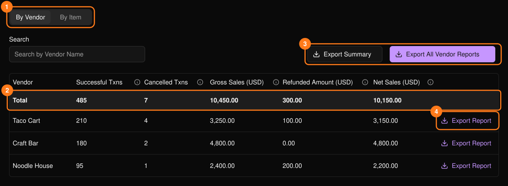
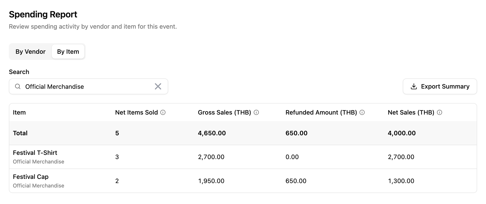

顯示活動中的消費總額。此功能位於活動側邊欄的 **PLVR Tap** 下。

<Frame>
  
</Frame>

在 **By Vendor**（依商家）與 **By Item**（依品項）之間切換（1），並使用 **Search**（搜尋）篩選。**Total**（總計）列（2）涵蓋所有符合搜尋條件的資料，而不只是目前頁面。Net Sales（淨銷售額）為 Gross Sales（總銷售額）扣除退款。將游標移到欄位的資訊圖示上即可查看定義。

<Frame>
  
</Frame>

## 匯出

匯出檔案為 Excel 格式。

- **Export Summary**（匯出摘要）（3）：目前分頁，並套用你的搜尋條件。
- **Export Report**（匯出報表）（4）：單一商家的結算報表。與該商家結算時使用。
- **Export All Vendor Reports**（匯出所有商家報表）（3）：每個商家各一份報表。檔案準備好後會自動下載。

## 相關內容

- [無現金交易紀錄](/zh-hant/tap/cashless-activity)
- [商家](/zh-hant/tap/vendors)
