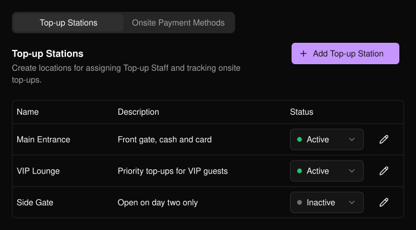
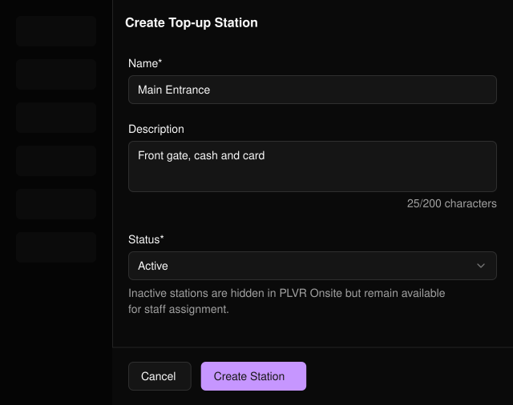
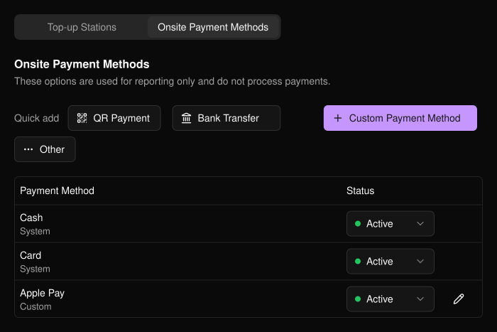

規劃參加者在現場儲值的地點與方式。此功能位於活動側邊欄的 **PLVR Tap** 下。

## 儲值站

儲值站是工作人員為參加者加值的實體地點，例如主入口或 VIP 區。透過儲值站，你可以將工作人員指派到特定地點，並依地點追蹤儲值紀錄。

<Frame>
  
</Frame>

<Steps>
  <Step title="Add Top-up Station">選擇此按鈕開啟表單。</Step>
  <Step title="填寫資料">名稱為必填。說明與狀態（預設為 Active）為選填。</Step>
  <Step title="Create Station">之後可使用鉛筆圖示編輯，或直接在表格中變更 **Status**（狀態）。</Step>
</Steps>

<Frame>
  
</Frame>

<Note>
停用的儲值站在 PLVR Onsite 中會被隱藏，但仍可用於指派工作人員。
</Note>

## 現場付款方式

這些是工作人員用來記錄參加者付款方式的選項。

<Warning>
這些選項僅供報表使用，並不會處理付款。請使用你自己的刷卡機、現金或其他方式收款。
</Warning>

使用 **Quick add**（快速新增）加入 Cash、Card、QR Payment、Bank Transfer 或 Other，或使用 **Custom Payment Method**（自訂付款方式）加入你自己的方式，例如 Apple Pay。只有自訂付款方式可以編輯。任何付款方式都可設為 **Active**（啟用）或 **Inactive**（停用）。

<Frame>
  
</Frame>

## 相關內容

- [PLVR Tap 總覽](/zh-hant/tap/introduction)
- [無現金交易紀錄](/zh-hant/tap/cashless-activity)
