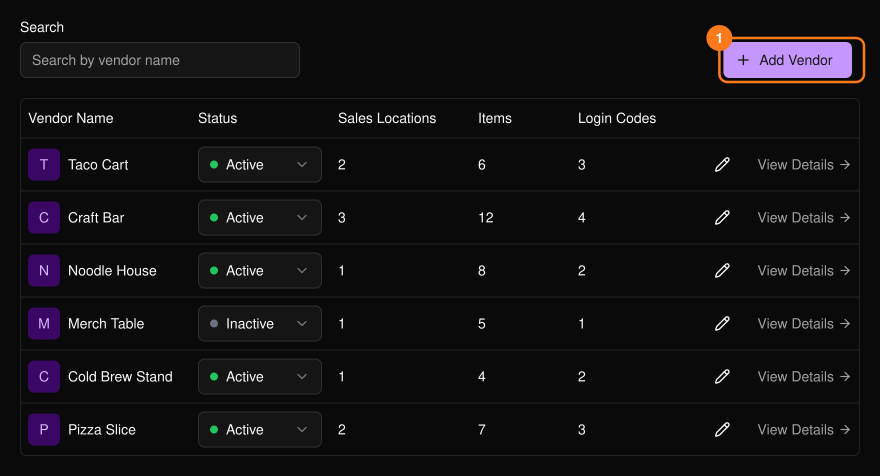
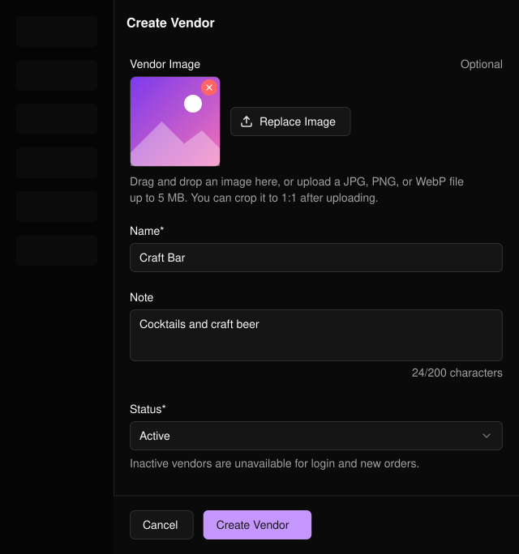
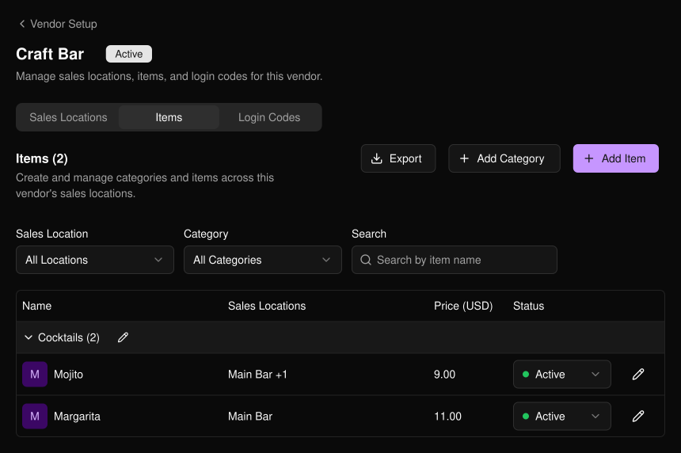
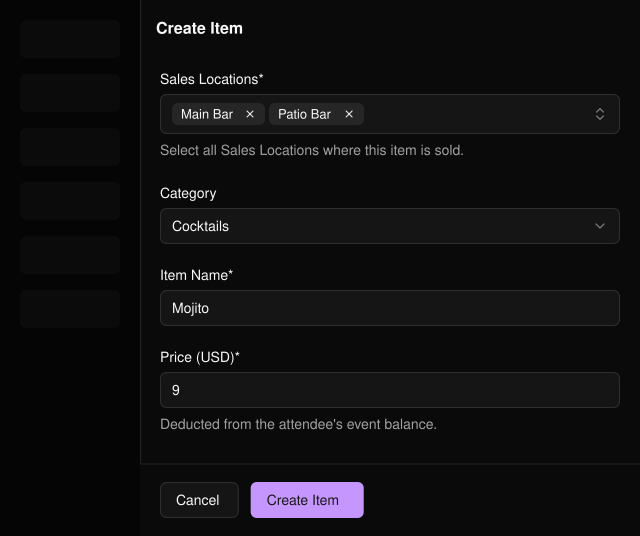
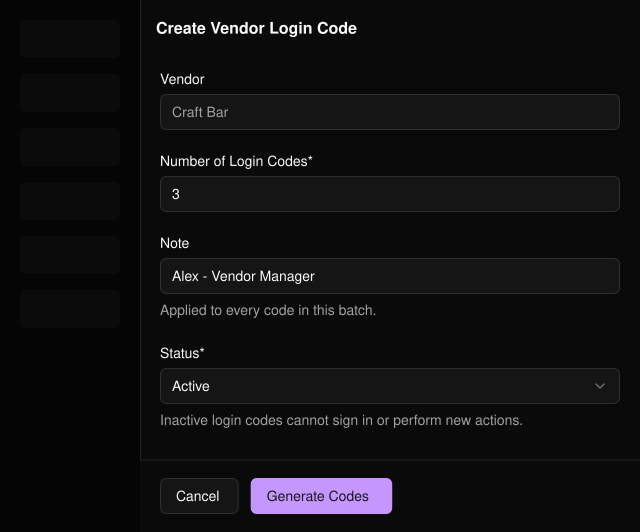

商家是透過掃描手環向參加者收款的攤位。**Vendor Setup**（商家設定）位於活動側邊欄的 **PLVR Tap** 下。

<Frame>
  
</Frame>

## 新增商家

<Steps>
  <Step title="Add Vendor（1）">選擇此按鈕開啟表單。</Step>
  <Step title="填寫資料">名稱為必填。圖片、內部備註與狀態為選填。</Step>
  <Step title="Create Vendor">點選商家名稱即可開啟。</Step>
</Steps>

<Frame>
  
</Frame>

<Note>
停用的商家、銷售地點與品項無法用於登入或接收新訂單。位於停用分類中的品項在任何地方都無法使用。
</Note>

## 設定商家

<Frame>
  
</Frame>

<Steps>
  <Step title="Sales Locations（銷售地點）">新增商家販售的每個地點，例如「Main Bar」。</Step>
  <Step title="Items（品項）">新增分類與品項。每個品項的價格須大於 0，且至少要有一個銷售地點。</Step>
  <Step title="Login Codes（登入碼）">一次可產生 1 至 200 組登入碼。備註會套用至整批登入碼。</Step>
</Steps>

<Frame>
  
</Frame>

商家自行提交的品項與分類會先經過[審核](/zh-hant/tap/approvals)。在 Items 與 Login Codes 分頁中使用 **Export**（匯出）即可下載 CSV。

<Frame>
  
</Frame>

<Warning>
停用的登入碼無法登入。若有人離開攤位或登入碼不小心外流，請將該登入碼設為 Inactive。
</Warning>

## 相關內容

- [審核](/zh-hant/tap/approvals)
- [消費報表](/zh-hant/tap/spending-report)
- [PLVR Tap 總覽](/zh-hant/tap/introduction)
