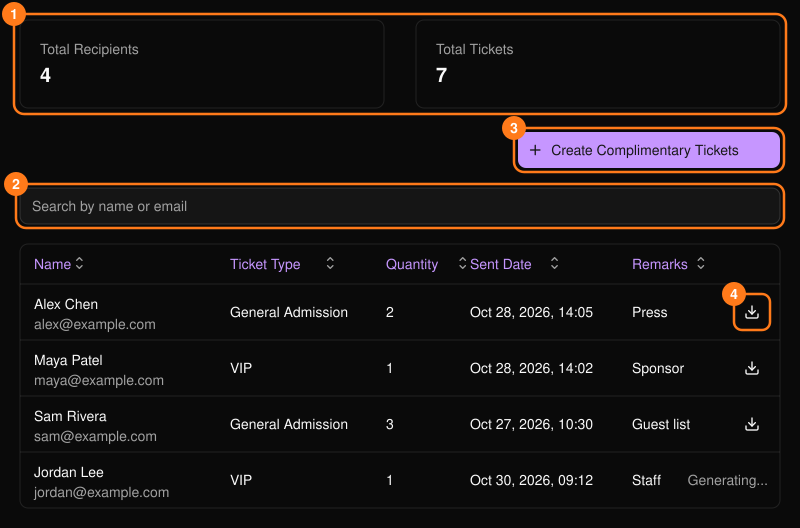
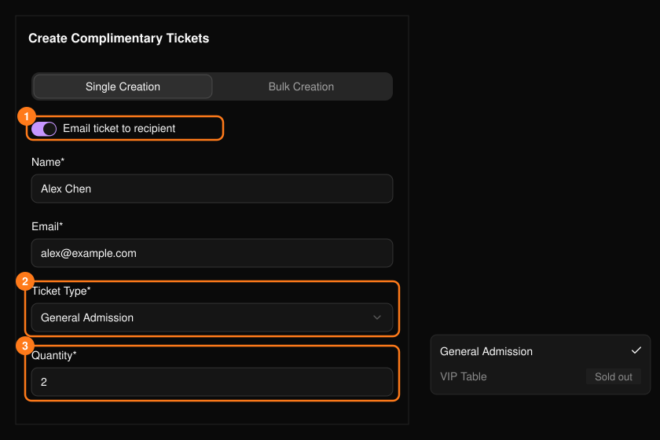
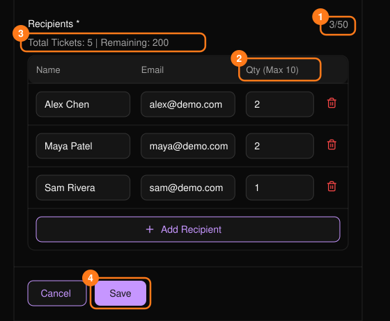
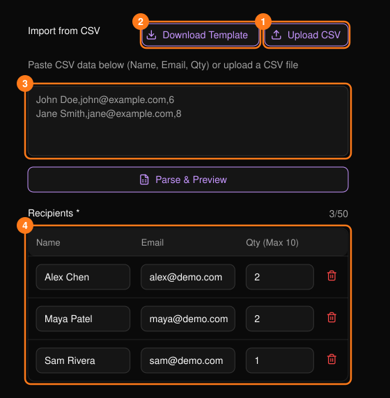

使用 **Complimentary Tickets**（招待票）將免費票券發給來賓、贊助商、媒體或工作人員。招待票與其他票券一樣會計入票券庫存。

<Frame>
  
</Frame>

可依姓名或電子郵件搜尋，並點選任一欄位標題排序。使用下載圖示即可取得收件人票券的 PDF。顯示 **Generating...**（產生中）的列仍在準備中，請稍後再查看。

## Single Creation（單筆建立）

選擇 **Create Complimentary Tickets**（建立招待票），然後使用 **Single Creation** 分頁。

<Frame>
  
</Frame>

- 姓名與有效的電子郵件為必填。
- 已售完的票種會以灰色顯示。
- 數量最多 50 張，且不得超過剩餘數量。
- **Email ticket to recipient**（以電子郵件寄送票券給收件人）僅適用於 10 張以下的數量。
- **Remarks**（備註，最多 200 字元）僅供你自己參考。

## Bulk Creation（批次建立）

一次將同一票種發給最多 **50 位收件人**。

<Frame>
  
</Frame>

<Steps>
  <Step title="選擇寄送方式與票種">
    選擇是否以電子郵件寄送票券，再選擇 **Session**（場次）與 **Ticket Type**（票種）。
  </Step>
  <Step title="新增收件人">
    新增列或匯入 CSV。每一列都需要姓名、電子郵件與數量。
  </Step>
  <Step title="檢查數量">
    每位收件人最多 50 張，以電子郵件寄送時最多 10 張；若剩餘票數較少則上限更低。若總數超過剩餘數量，系統會要求你調整。
  </Step>
  <Step title="儲存">
    **Remarks** 會套用至整批票券。
  </Step>
</Steps>

### 從 CSV 匯入

使用 **Upload CSV**，或貼上資料列後選擇 **Parse & Preview**（解析並預覽）。**Download Template**（下載範本）可取得起始檔案。欄位依序為：

```csv
Name,Email,Quantity
John Doe,john@example.com,1
```

- 標題列為選填。姓名不可包含逗號。
- 若有無效的列，匯入會停止，並指出需要修正的行。
- 匯入的列會計入 50 位上限，且可在儲存前編輯。

<Frame>
  
</Frame>
