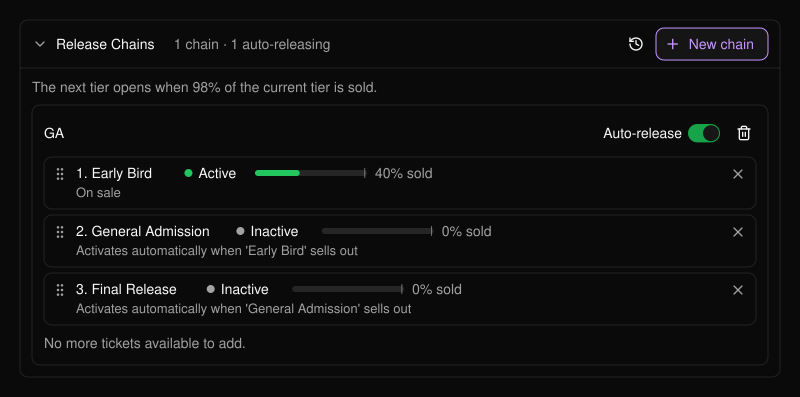
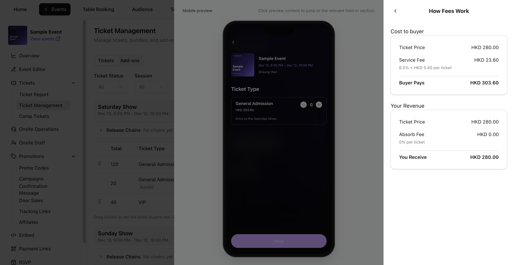

```text
Event
 └── Session (a day, a show, a time slot)
      ├── Tickets  (Early Bird, General Admission, VIP ...)
      │     └── optionally in a Release Chain (one tier opens after another)
      ├── Bundles  (a ticket sold as a pack)
      └── Add-ons  (parking, merchandise, extras)
```

以上所有項目都在[票券管理](/zh-hant/tickets/ticket-management)中管理。

## 場次

**場次**（session）是參加者可以出席的一個時段，例如週五晚上或某一天的演出。每個票種與套票都隸屬於一個場次。例如，週五票僅適用於週五場次。只有當活動有多個場次時，才會出現場次篩選器與欄位。請參閱[多日音樂節](/zh-hant/tickets/scenario-multi-day-festival)。

## 票種

**票種**（ticket type）是一種票券，各自擁有獨立的價格、數量、銷售期間、狀態與必填的購買上限。

<Frame>
  
</Frame>

| 狀態 | 說明 |
| --- | --- |
| **Active**（啟用） | 開賣日期到達後即開放銷售並公開顯示。 |
| **Inactive**（停用） | 對買家隱藏。可用來保留或暫停販售某個票種。 |
| **Ended**（已結束） | 銷售結束時間過後自動設定，無法重新啟用。 |

- **Total ticket quantity**（票券總數量）是該票種的庫存上限。請依場地容量規劃各票種的數量，並在庫存中預留招待票。
- **Tickets per order**（每筆訂單張數，1–10）與 **Tickets per buyer**（每位買家張數，1–20）為必填，以票券張數計算。上限分別套用於各票種。
- **Ticket name**（票種名稱）與 **Price per ticket**（單張票價）在該票種庫存首次售出或發出後即會鎖定。鎖定與庫存規則請參閱[編輯票種或套票](/zh-hant/tickets/ticket-management)。

## 釋票鏈

**釋票鏈**（release chain）會將票種依序排列，例如早鳥票、一般票、最後一波，並在目前票種即將售完時自動開放下一個階段。請參閱[釋票鏈](/zh-hant/tickets/ticket-management)與[分階段販售一般票](/zh-hant/tickets/scenario-ga-tiers)。

<Frame>
  
</Frame>

## 套票

**套票**（bundle）是將同一場次的同一票種組合成一組販售，例如四人套票。套票與所含票種共用庫存。**Bundle sales limit**（套票銷售上限）限制可售出的套票總組數。**Available now**（目前可售）會同時反映剩餘的套票上限與剩餘的共用票券庫存。

**Bundles per order**（每筆訂單組數）與 **Bundles per buyer**（每位買家組數）以組為單位設定。PLVR 會將數量換算為票券張數，以執行每筆訂單 10 張、每位買家 20 張的上限。以四人套票為例，即每筆訂單最多 2 組、每位買家最多 5 組。**Sold**（已售出）對套票以組數計算，對票種則以張數計算。

請參閱[建立套票](/zh-hant/tickets/ticket-management)與[團體套票](/zh-hant/tickets/scenario-bundles)。

## 加購項目

**加購項目**（add-on）是與票券一同購買的額外項目，例如停車位。每個加購項目都會連結到可搭配購買的票種，並擁有獨立數量或與某個票種共用數量。請參閱 [VIP 與加購項目](/zh-hant/tickets/scenario-vip-addons)。

## 費用

**Price per ticket**（單張票價）與 **Price per bundle**（每組套票價格）是你輸入的基本價格，不含買家手續費與稅金。套票價格為整組的價格。

- **All-in pricing**（含費總價）會預先向買家顯示完整價格，包含適用的買家手續費與稅金。
- **Split pricing**（分開計價）會預先顯示基本價格，並在結帳時加上適用的買家手續費與稅金。

在 **Pricing**（定價）下查看 **Buyer pays**（買家支付）與 **You receive**（你的實收），然後開啟 **How fees work**（費用說明）查看買家服務費、你吸收的費用以及稅金。啟用稅金時，**You Receive (incl. tax)**（你的實收，含稅）會包含代收的稅金。未含稅的金額請參閱 **Revenue excluding tax**（未稅營收）。套票明細顯示的是整組的金額。以下範例採用 Sample Event 的費用設定。

<Frame>
  
</Frame>

## 優惠碼與招待票

[優惠碼](/zh-hant/promotions/promo-codes)可為所有票券或單一票種或套票提供折扣。[招待票](/zh-hant/tickets/comp-tickets)是發給指定對象的免費票券，與付費票券使用相同的庫存。請參閱[折扣活動](/zh-hant/tickets/scenario-promo-discounts)與[招待來賓](/zh-hant/tickets/scenario-comp-guests)。
