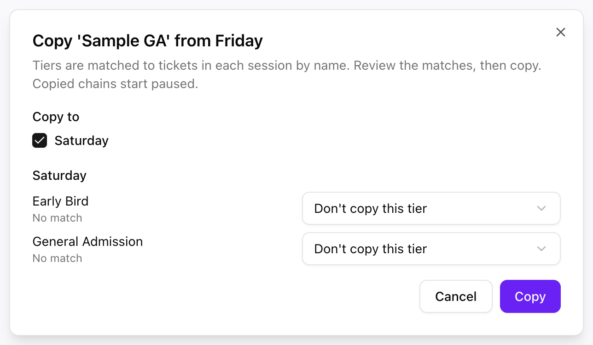

**目標：**週五、週六與週日各自獨立販售與統計。

| 場次 | 票券 | 數量 | 價格 |
| --- | --- | --- | --- |
| 週五 | Day Pass（單日票） | 400 | $40 |
| 週六 | Day Pass | 600 | $55 |
| 週日 | Day Pass | 400 | $40 |

每一天都是一個**場次**，各自擁有容量、價格與販售期間。週六售完不會影響週五。

<Note>
  場次與其票券會隨活動一起設定。如需新增一天或新票種，請聯絡你的 PLVR 窗口。
</Note>

## 檢查每一天

在[票券管理](/zh-hant/tickets/ticket-management)中，檢查每個場次的 **Price**（價格）、**Total**（總數）與日期；為熱門的日子設定購買上限；並在正式公布前將該日維持 **Inactive**（停用）。

{/* SCREENSHOT: images/tickets/multi-day-ticket-management.png | Ticket Management for the three-session example. Callouts: 1 Session filter, 2 the three per-session tables. */}

## 每一天都分階段

先在一個場次建立[釋票鏈](/zh-hant/tickets/scenario-ga-tiers)，接著：

<Steps>
  <Step title="複製">
    在釋票鏈卡片上選擇 **Copy to...**（複製到…），並勾選其他場次。
  </Step>
  <Step title="檢查比對結果">
    系統會依票券名稱比對各階段。若未比對成功，請選擇正確的票券，或選擇 **Don't copy this tier**（不複製此階段）。
  </Step>
  <Step title="開啟 Auto-release">
    複製出來的釋票鏈預設為暫停。修正所有被標示的結束時間後，再到每個場次中開啟 **Auto-release**（自動釋票）。
  </Step>
</Steps>

<Frame>
  
</Frame>

<Tip>
  每一天都使用相同的票券名稱，複製與報表都會更簡單。
</Tip>

適用於所有天數的通行票無法在此後台中建立。請與你的 PLVR 窗口洽詢。

## 追蹤與營運

- [票券報表](/zh-hant/tickets/ticket-report)：依 **Session**（場次）篩選，查看單日銷售。
- [招待票](/zh-hant/tickets/scenario-comp-guests)：選擇 **Session**，讓來賓拿到正確日期的票。
- [優惠碼](/zh-hant/tickets/scenario-promo-discounts)：針對某個場次的某種票券提供折扣，帶動銷售較慢的日子。

{/* SCREENSHOT: images/tickets/multi-day-ticket-report-session.png | Ticket Report on the multi-day event with Saturday chosen in the Session filter. Capture the filters, summary cards and Export button. */}
