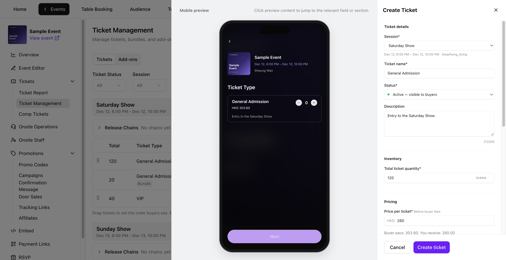
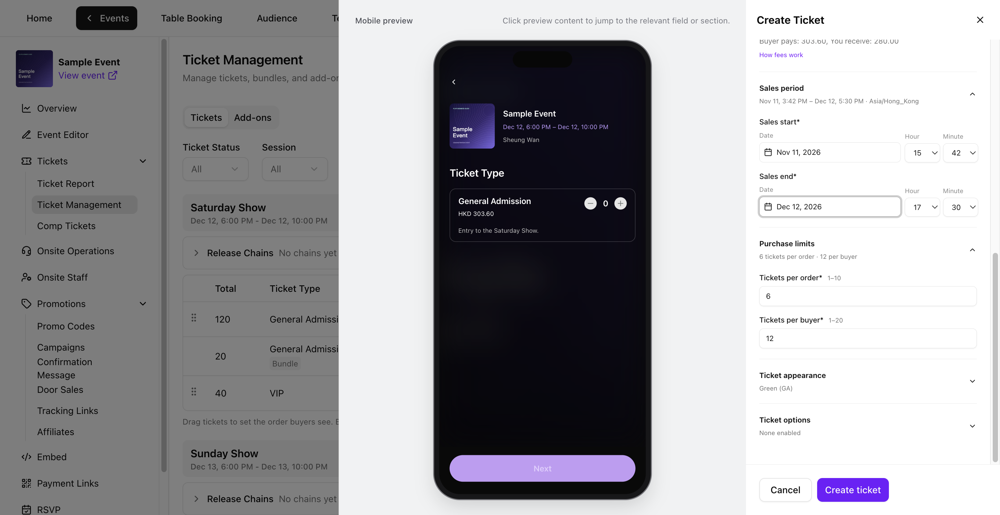
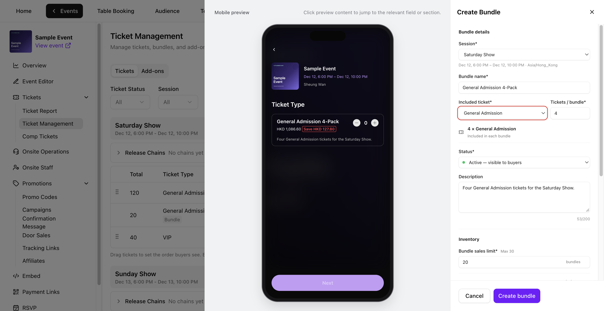
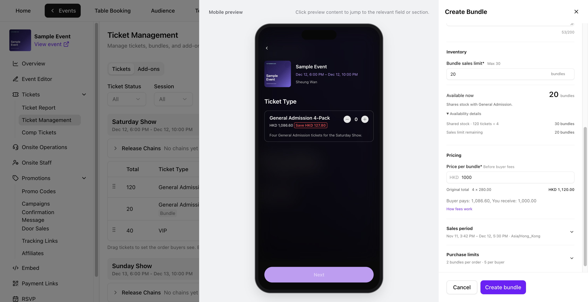
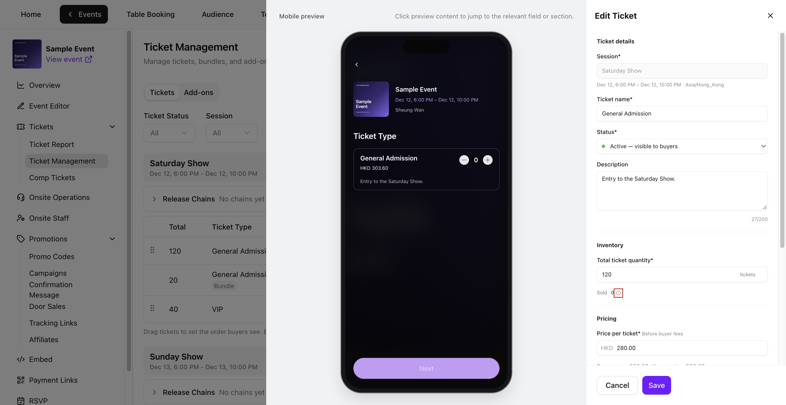
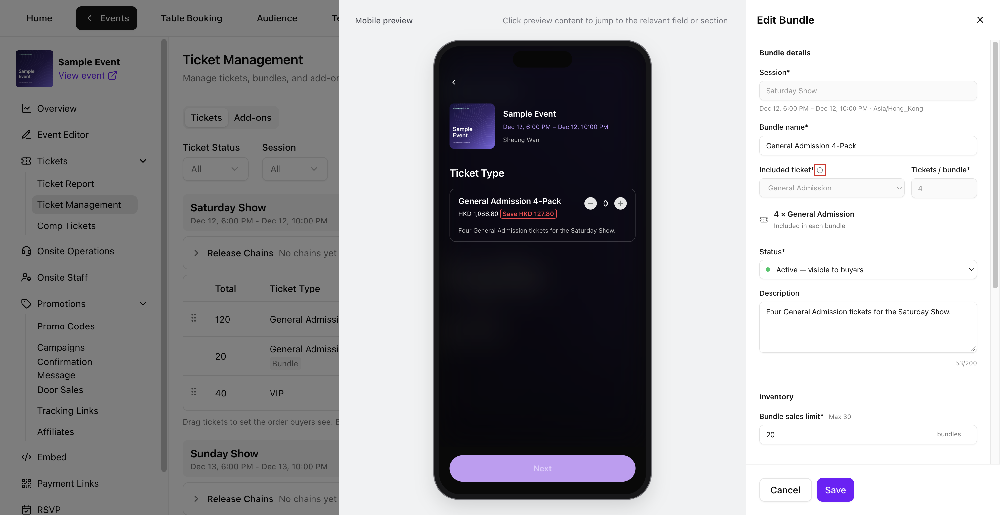
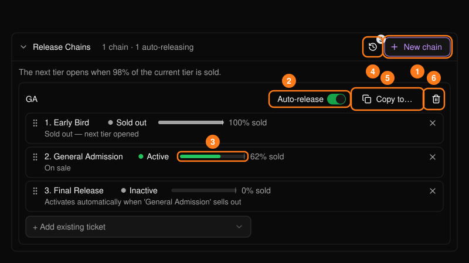
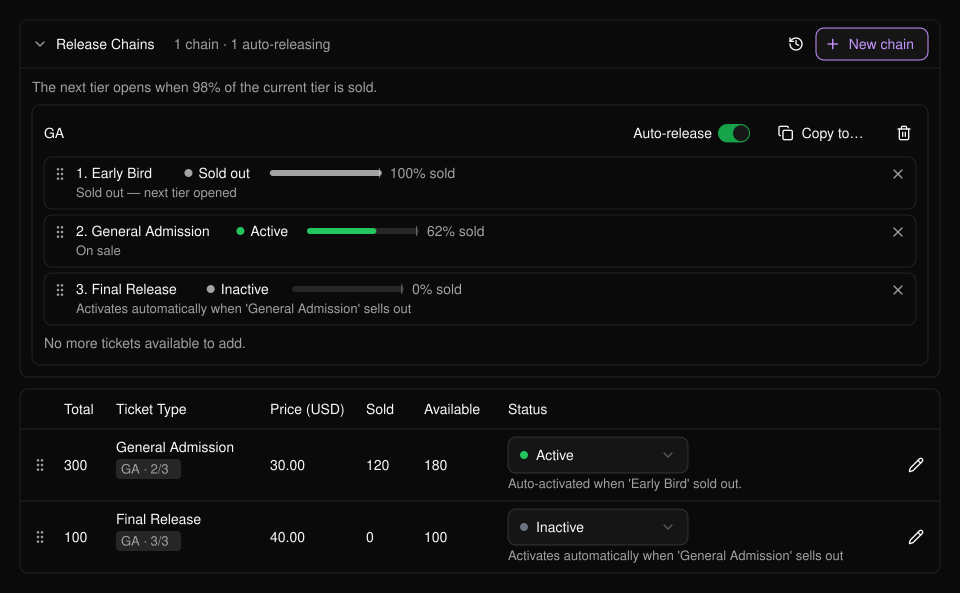
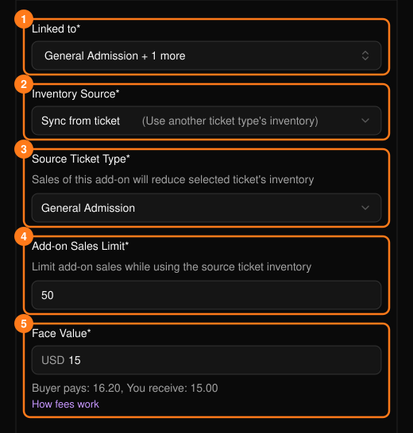
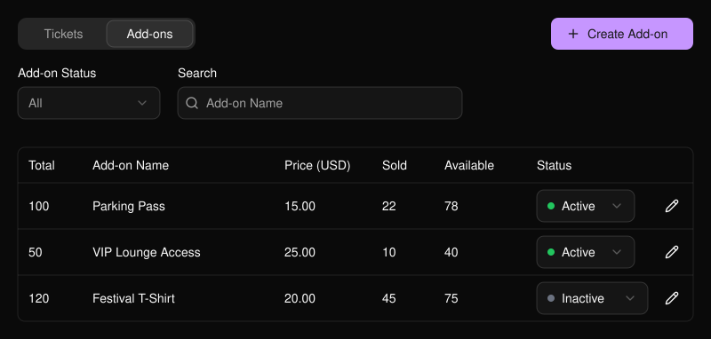

開啟你的活動，前往 **Tickets → Ticket Management**（票券管理）。在 **Tickets** 分頁中，可依 **Ticket Status**（票券狀態）篩選，或依票種或套票名稱搜尋。若為多場次活動，請使用 **Session**（場次）篩選器或展開場次。加購項目位於 **Add-ons** 分頁。

<Frame>
  
</Frame>

## 建立票種

在 **Tickets** 分頁中選擇 **Create ticket**（建立票券）。點選 **Mobile preview**（行動版預覽）中的名稱、說明或價格，即可跳到該欄位。

<Frame>
  
</Frame>

<Steps>
  <Step title="輸入票券資訊">
    - 若活動有多個場次，請選擇 **Session**。
    - 輸入 **Ticket name**（票種名稱）並選擇 **Status**（狀態）。**Inactive** 會讓票券保持隱藏。
    - 可選填最多 200 字元的 **Description**（說明）。
  </Step>
  <Step title="設定庫存與價格">
    - 在 **Inventory**（庫存）下，輸入至少為 1 的 **Total ticket quantity**（票券總數量）。
    - 在 **Pricing**（定價）下，以活動幣別輸入基本的 **Price per ticket**（單張票價）。免費票請輸入 **0**。
    - 查看 **Buyer pays** 與 **You receive**。選擇 **How fees work** 查看費用與稅金明細。請參閱[費用](/zh-hant/tickets/concepts)。
  </Step>
  <Step title="設定買家可購買的時間與數量">
    - 開啟 **Sales period**（銷售期間），以活動時區設定 **Sales start**（開賣）與 **Sales end**（停售）的日期與時間。停售時間須晚於開賣時間、位於未來，且不晚於場次結束時間。
    - 開啟 **Purchase limits**（購買上限），設定 **Tickets per order**（1–10）與 **Tickets per buyer**（1–20）。兩者皆為必填。
  </Step>
  <Step title="檢查票券設定並建立">
    - 在 **Ticket appearance**（票券外觀）下選擇顏色並查看 QR 預覽。
    - 在 **Ticket options**（票券選項）下，視需要設定 **Require Personalization**（需要個人化）或 **Allow ticket transfer**（允許轉讓票券）。個人化問題請在[個人化表單](/zh-hant/tap/personalization-form)中設定。啟用 PLVR Tap 時，也可以開啟 **Support wristband binding**（支援綁定手環）。
    - 檢查 **Mobile preview**，然後選擇 **Create ticket**。新票種會出現在列表中。
  </Step>
</Steps>

<Frame>
  
</Frame>

## 建立套票

若要將同一票種組合成套票販售，請先建立該票種。在 **Tickets** 中選擇 **Create bundle**（建立套票）。

<Steps>
  <Step title="選擇所含票種">
    若出現提示，請選擇 **Session**。輸入 **Bundle name**（套票名稱），從該場次選擇一個 **Included ticket**（所含票種），並設定 **Tickets / bundle**（每組張數，1–10）。設定 **Status**，並可選填最多 200 字元的 **Description**。
  </Step>
  <Step title="設定套票上限與價格">
    設定 **Bundle sales limit**（套票銷售上限）以及整組的基本 **Price per bundle**（每組價格）。**Original total**（原價合計）會顯示相同張數單張票的基本價格。
  </Step>
  <Step title="設定銷售期間與購買上限">
    設定必填的 **Sales period**、**Bundles per order**（每筆訂單組數）與 **Bundles per buyer**（每位買家組數）。停售時間不得晚於場次結束時間。上限為每筆訂單 10 張、每位買家 20 張。四人套票即每筆訂單最多 2 組、每位買家最多 5 組。
  </Step>
  <Step title="檢查並建立">
    檢查 **Mobile preview**，然後選擇 **Create bundle**。套票會與其所含票種一起顯示。
  </Step>
</Steps>

<Frame>
  
</Frame>

### 檢查共用庫存

每組套票都會使用所含票種的庫存。**Bundle sales limit** 的最大值為所含票種總數量除以 **Tickets / bundle**，無條件捨去。

**Available now**（目前可售）取剩餘套票上限與共用庫存可湊成的完整組數兩者中較小的值。展開 **Availability details**（可售明細）即可查看兩者。在 Sample Event 中，120 張票可湊成 30 組四人套票，但銷售上限只剩 20 組，因此 **Available now** 顯示 20。

<Frame>
  
</Frame>

## 開啟或關閉票種

使用 **Status** 欄位中的下拉選單。**Active** 會在銷售期間開放時讓項目對買家可見。**Inactive** 會對買家隱藏。**Ended** 會在停售後自動設定，無法透過狀態下拉選單變更。

若要暫停某場次的所有銷售，請將該場次的每個票種與套票設為 **Inactive**。要恢復銷售時，再將要販售的項目改回 **Active**。

## 編輯票種或套票

點選該列的鉛筆圖示，開啟 **Edit Ticket** 或 **Edit Bundle**。選擇 **Save**（儲存）套用變更。選擇 **Cancel**（取消）後，若出現提示，請選擇 **Keep editing**（繼續編輯）或 **Discard changes**（捨棄變更）。

<Frame>
  
</Frame>

| 欄位 | 鎖定時機 |
| --- | --- |
| **Ticket name** 與 **Price per ticket** | 該票種庫存首次售出或發出後，包括免費票、招待票，以及透過套票或同步加購項目使用的庫存。 |
| **Bundle name** 與 **Price per bundle** | 該套票首次售出或發出後。 |
| **Session** | 建立票種或套票時。 |
| **Included ticket** 與 **Tickets / bundle** | 建立套票時。 |

即使之後銷售被退款或庫存被回補，名稱與價格仍會保持鎖定。

<Frame>
  
</Frame>

### 調整數量與銷售設定

- **Total ticket quantity** 可調整為不低於 **Sold**（已售出）的整數，最小值為 1。票種的 **Sold** 以張數計算已售出或已發出的票券，包括招待票，以及套票和同步加購項目使用的庫存。點選 **Sold** 旁的資訊圖示可查看明細。
- **Bundle sales limit** 可調整為不低於套票 **Sold** 的整數，最小值為 1。套票的 **Sold** 以組數計算。套票上限僅適用於該套票。
- 你可以更新 **Status**、**Description**、**Sales period** 與 **Purchase limits**。變更 **Sales end** 時，請選擇未來且不晚於場次結束的時間。

## 釋票鏈

釋票鏈會依序販售各階段票種，並在目前階段即將售完時自動開放下一個階段。下一個階段會在面板顯示的百分比（例如 98%）時開放，不一定是最後一張票售出時。實際範例：[分階段販售一般票](/zh-hant/tickets/scenario-ga-tiers)。

<Frame>
  
</Frame>

<Steps>
  <Step title="建立釋票鏈">
    開啟 **Release Chains**（釋票鏈），選擇 **New chain**，輸入名稱後選擇 **Create**。新建立的釋票鏈預設為暫停狀態。
  </Step>
  <Step title="依序加入票種">
    使用 **+ Add existing ticket** 加入票種，再拖曳調整順序。每個票種只能屬於一個釋票鏈。套票與加購項目無法加入。
  </Step>
  <Step title="開啟 Auto-release">
    關閉 **Auto-release**（自動釋票）時，釋票鏈會處於暫停狀態，後續階段不會啟用。
  </Step>
</Steps>

每個階段都會顯示其狀態：等待中、**On sale**（販售中）、已售完並已開放下一階段，或警告。已加入釋票鏈的票種會在表格中顯示如「GA - 2/3」的標籤，全部完成的釋票鏈會顯示 **Exhausted**（已用盡）。

<Frame>
  
</Frame>

有兩個值得留意的警告：

- 標示「won't auto-activate」（不會自動啟用）的階段，表示後面的階段已在販售中。請手動啟用或將其移除。
- 每個階段都需要尚未過期且順序合理的停售時間。請修正被標示的階段，再重新開啟 Auto-release。

其他控制項：**Activity log**（活動紀錄，記錄售完與啟用的歷程）、**Copy to...**（依票種名稱比對，將釋票鏈複製到其他場次，複製後預設為暫停）以及 **Delete**（刪除，票種會保留原本的狀態）。

## 加購項目

在 **Add-ons** 分頁中選擇 **Create Add-on**（建立加購項目）。

<Frame>
  
</Frame>

- **Linked to**（連結至）：可搭配購買此加購項目的票種。
- **Inventory Source**（庫存來源）：**Own inventory**（獨立庫存）給予獨立數量。**Sync from ticket**（與票種同步）會從某個票種的庫存扣除，因此每售出一個加購項目，該票種的可售數量就會減少。
- **Face Value**（面額）：價格。
- 銷售日期為選填。庫存來源建立後即無法變更。

<Frame>
  
</Frame>

另請參閱[票務概念](/zh-hant/tickets/concepts)、[票券報表](/zh-hant/tickets/ticket-report)與[招待票](/zh-hant/tickets/comp-tickets)。
