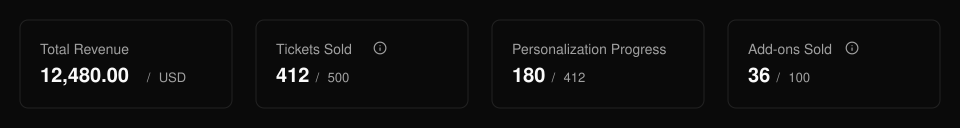
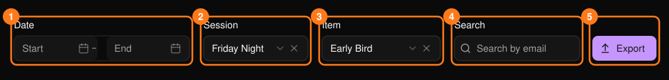
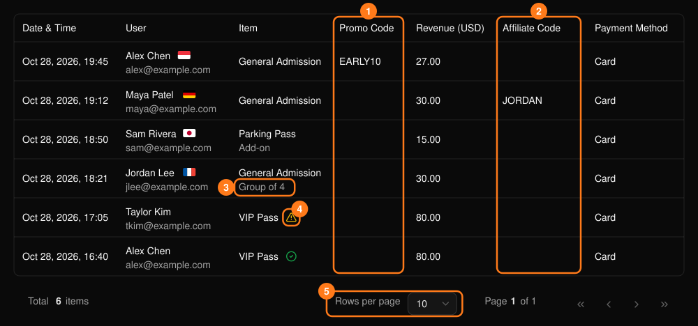

**Ticket Report**（票券報表）會列出每一張售出的票券與加購項目，包括買家、時間與營收。

<Frame>
  
</Frame>

摘要卡片會顯示營收、售出票數、個人化進度與加購項目售出數。後兩者僅在活動有使用時才會顯示。

## 篩選

<Frame>
  
</Frame>

- 使用 **Start**（開始）與 **End**（結束）日期選擇器聚焦於特定報表期間。
- **Session**（場次）僅在多場次活動中顯示。
- 請先選擇場次，再選擇 **Item**（項目）。變更場次會清除已選的項目。
- **Search**（搜尋）會比對買家電子郵件，支援部分比對。

## 閱讀表格

<Frame>
  
</Frame>

每一列代表一張票券或一個加購項目。加購項目會加上標籤，套票中的票券會顯示套票名稱。對於需要個人化的活動，警告圖示代表 **Personalization Required**（需要個人化），綠色勾號代表 **Personalized**（已個人化）。

表格包含：

- **交易明細：** 日期與時間、買家、票種、營收與付款方式。
- **Promo Code 與 Affiliate Code：** 辨識與該筆銷售相關的優惠碼或推廣夥伴。

## 匯出

**Export**（匯出）會依目前的篩選條件下載 CSV，因此請先套用日期範圍、場次、項目或搜尋條件。

若想了解哪些因素帶動銷售，請查看 **Promo Code** 與 **Affiliate Code** 欄位。請參閱[優惠碼](/zh-hant/promotions/promo-codes)與[推廣夥伴](/zh-hant/promotions/affiliates)。
